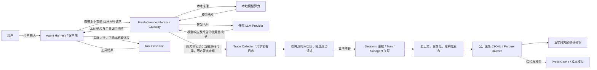
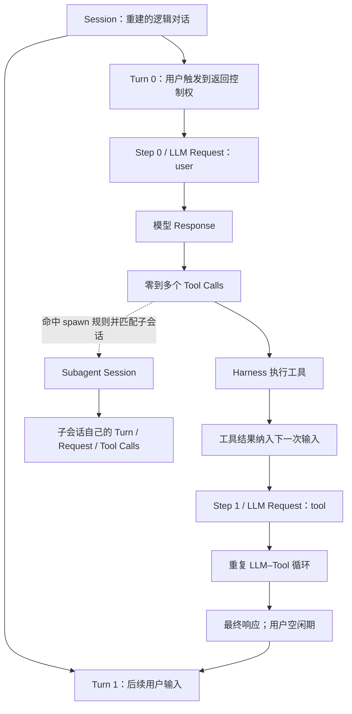

# FreeInference 的采集位置、执行层次与发布流程

审计基准：官方仓库 `HarvardMadSys/freeinference_agentic_trace`，commit `2b795dbf5eac490a7c081906fdce6cc7a184b7ef`；论文 PDF 共 18 页。下文的 Verified 指论文或固定源码可直接确认，**不表示我们部署了 FreeInference、重跑了原始日志采集或验证了真实工具执行时间**。本报告只讨论该 Agent trace，不涉及其他网络实验。

## 1. 采集的是推理服务工作负载

**Verified：论文采集点在 FreeInference 推理服务侧。** 论文 §3（PDF p3）说明 FreeInference 通过本地算力和远端 API 提供模型服务，记录请求输入、模型输出、tool-call 及时间、token、用户等元数据；§9（p13）明确称其为 provider-side view，并承认没有精确的 client-side tool execution latency。公开导出代码把输入称为 `gateway weekly export`。另经官网当前版本链接，发现公开 Gateway 实现 `HarvardMadSys/hybridInference@7f7585bc60a303f9dc8e2a0f219ab7f0b99f3255`，补充核对了其在线处理和日志路径。这个当前源码快照**不能证明 2026 年 5–9 月历史 trace 使用了相同部署版本**；原始历史打点、配置与部署对应关系仍为 Unknown。[P3] [P13] [C-BUILD] [G-START]

这里的 provider-side 是相对于 Agent 客户端的位置描述，不能推导成所有测量都来自最终模型供应商内部。模型可能在本地运行，也可能由 FreeInference 转发给其他服务。对外部转发请求，论文使用上游报告的 latency；TTFT 可能包含内部缓冲或排队，不能统一解释成客户端看到首个网络包的时延。[P3]

数据导出代码把 raw `timestamp` 解释为 completion/end，再减 latency 得到 start；这是**转换规则事实**。不能把变量名或推导公式当成两个独立时间测量。

当前 Gateway 源码提供了更具体的证据：chat handler 在 `start_time=time.time()` 处开始计时；stream 完成后安排异步日志，`latency_ms` 是相对该 start 的 wall time。`api_logs.timestamp` 的 schema 默认为数据库 `NOW()`，写入列未覆盖 timestamp，`grant_auth.py` 还明确注释它是 response completed 后才调度的 **DB insert time**。因此当前代码的 timestamp 不是“最后 provider chunk”的直接打点，日志队列和 DB/Gateway 时钟差必须进入对齐误差模型；**不能由此断言历史数据的误差数值**。当前 `request_started_at` 只给 grant-authenticated 请求增加，普通流量不增加该 metadata。[G-START] [G-STREAM] [G-DB] [G-SCHEMA] [G-ATTR] [G-LOGGING]

当前 TTFT tracker 在首个 meaningful delta（内容、tool-call 或 reasoning 等）记时，fallback 在尚未出 token 时可重置 TTFT 参考时钟，但 latency 保留整个请求的 wall time。它也不是客户端首包时间，且不能把这套当前实现自动外推到历史 trace。[G-TTFT]

图中的实线表示论文描述或代码实现的逻辑数据路径，**不是 packet capture 证据**；虚线表示推断或模拟。Tool Execution 不直接连到 Trace Collector：服务端看到的是 Harness 后续提交的结果，而非工具端独立遥测。网络抓包、客户端 hook、工具端 span、TLS 密钥、网络连接标识未出现在该发布流程中。[P3] [P13] [C-RESULT]

## 2. 一次 Agent 交互的层次

论文 §2.1（p2）定义 Session 为用户与 Agent 的持续交互，Turn 为一个用户请求启动的自主执行过程，Step 为其中一次模型请求。一个用户 task 可能跨多个 Turn；不能仅凭 session ID 声称全部内容属于同一语义任务。[P2]

**Verified：公开层次包含算法决定。** 一个 session 的请求先组成有向父子关系，再只保留 root 到最深后代的 main chain；其他分支保留在私有 `links.parquet` / `chains.parquet`，不进入发布请求表。常规 human-driven session 至少有 1 个 tool-triggered step 和 2 个 user-triggered step，SWE-Bench 只要求前者；发布集合还递归纳入这些 session 所匹配的子会话。因此发布的“完整 session structure”是所选主链及匹配子会话的结构，而不是同账户全部并发请求组成的原始执行 DAG。[C-CHAIN] [C-RELSESSION]

`step` 在 session 内从 0 开始。JSONL 的 `turn_index` 从 0 开始，后续遇到 `step_trigger=user` 才加一；Parquet 请求表不存 `turn_index`，它由顺序和触发标签导出。JSONL 的 session `start_ms/end_ms` 来自请求的最小开始时间/最大结束时间；Parquet session 表只保留 ID、账户、harness 与父子关联 6 列，时间需从请求表聚合。把 JSONL 示例字段直接当成 Parquet Schema 会出错。[C-TRACE] [C-SCHEMA]

必须区分：Session ≠ TCP Flow；Step/LLM Request ≠ 单个 Packet Burst；Tool Call ≠ 一次网络请求；Subagent Session ≠ 一条新网络连接。一个工具可能只操作本地文件，也可能访问多个远端资源；一个长连接也可以承载很多请求。这份应用层发布数据没有证据支持这些实体之间一一对应。[C-SCHEMA] [P13]

## 3. 字段怎样从原始日志到公开数据

| 层次 | 可确认的变换 | 不能据此确认的内容 |
|---|---|---|
| 原始服务侧日志 | 读取 raw timestamp、latency、TTFT、model_id、provider、usage、prompt、response、tools | 在线埋点实现、客户端 wire time、实际模型权重或上游执行的独立证明 |
| 请求筛选 | 只保留 status 200、可读 ID/时间、允许账户、已识别 harness；未识别 other-agent 被排除 | 非 200、重试、未识别 agent 的完整行为分布 |
| 时间 | `end_ms` 解析原始完成时间；`start_ms = end_ms - (latency_ms or 0)` | start_ms 不是独立测得的客户端发出事件；缺失 latency 时不是“零耗时证明” |
| Harness | 前 6 个输入条目中的 system/user 文本、前 20K 字符，按 phrase 规则；无命中再看 UA；session 使用 root 的 harness | 认证过的客户端身份、每步实际客户端程序 |
| 模型与 Provider | `model_id` 原值发布为 model；provider 通过私有字典映射为匿名字母 | 真实 provider 名称、服务器 IP、硬件、供应商内部排队明细 |
| Session / Turn | 输出重放匹配、tool-call ID 匹配、主链选择和触发规则 | 客户端真实任务边界、绝对准确的用户/工具来源 |
| 工具信息 | 从模型响应解析调用；从下一步输入匹配结果；工具类别、结果状态和参数结构由规则计算 | 工具端 span、精确开始结束、语义任务成功 |
| 发布 | keyed hash ID；去正文；工具词白名单与 typed placeholders；16-token block 的 week-local ID | 原始 prompt/response/tool result、跨周 block 内容相同的直接比较 |

对应源码：[C-FIELDS]、[C-EXTRACT]、[C-HARNESS]、[C-PSEUD]、[C-RESULT]、[C-PRIVACY]。工具延迟并非每个工具的秒表测量：发布代码取下一请求推导的 start 减当前请求 end，同批工具共享该值；用户审批、排队、串并行和传输可能混在其中。[C-LATENCY] [P13]

另有需保留的方法差异：论文 §5（p5）定义 effective tool latency 时说排除估计 network RTT；当前 `tool_latencies()` 和 `paper.metrics.tools.tool_waits()` → `turns.waits()` 路径都直接使用相邻 start/end gap，未在这些公开路径定位到 RTT 估计或扣除。原始日志是否另有上游校正 Unknown，不能将当前 gap 计算称为已验证的 RTT-corrected 工具执行时间。[P5] [C-LATENCY] [C-TOOLWAIT] [C-WAITS]

**Verified：Harness 描述存在具体版本差异。** 论文 p3 写“UA 可用时优先，否则 system prompt”；固定 SHA 中 `harness_name()` 实际先查 phrase，后查 UA，phrase 窗口也包括 user 文本。我们不能据此声称论文当时在线使用了现版本优先级，也不能忽略这处差异。应以当前 SHA 重建逻辑、将原论文版本逻辑列为 Unknown。[C-HARNESS]

当前配置 `harnesses-v3-2026-09-30` 列出 13 个人类使用类别：`claude-code`、`kilo`、`openhands`、`opencode`、`cline`、`codex`、`oh-my-pi`、`pi`、`hermes`、`openclaw`、`zcode`、`copilot`、`zoo`，另有 `eval:swe-bench`。这只是规则表的支持集合，类别占比和观测到的缺失类别须以真实 release 统计为准；不是所有 Agent 的完整清单。[C-HCONFIG]

## 4. 匿名化能保留什么

同一私有 salt 下，session/trace ID 通过带 key 的 BLAKE2b 变为 32 个十六进制字符，账户 ID 为 16 个字符；provider 的真实映射和 salt 不公开。模型字符串保留。原始 request ID 最终不发布，请求主键变为 `(session_id, step)`。[C-PSEUD] [C-REQUEST]

工具名、program label、参数 key、命令 skeleton word 和公开 subagent type 采用词表：通常需至少 3 个不同账户使用，另外允许维护者手工加入 public list；非公开内容变为 `other` 或 typed stand-in。类别先从完整信息计算，再隐藏名称。因此匿名的 `other` 工具名仍可有非 Other 类别；不能用匿名名称反推规则失败。参数 skeleton 保留类型及部分公共命令结构，**不等于原始参数**。[C-PUBWORDS] [C-TOOLPRIV]

发布前 schema、ID/IP/取值格式检查是可见的软件控制；这不构成形式化匿名性或零再识别风险的证明。公开 trace 有可长期关联的账户假名和精细行为时间，后续网络研究仍需明确授权与数据最小化。[C-PRIVACY]

对网络侧研究最直接的用途是：定义应用层目标、理解标签噪声和设计配对采集。历史发布数据没有与任意独立 PCAP 共享的原始 request ID 或网络连接字段，不能直接变成 PCAP 监督标签。具体配对采集方案见 `trace_pcap_alignment.md` 与 `mvp_experiment_plan.md`。

当前 Gateway 的普通用户 recent-requests API 可返回自己的请求元数据，属于后续自采实验的候选来源，不是历史公开 trace 的实时导出保证。还要区分三个 ID：middleware 的 `X-Request-ID`、handler 为 DB 生成的内部 request ID、发给客户端的 SSE completion ID。当前代码的 DB metadata 保存 response/completion ID，但普通 recent-requests 的已审响应不暴露它；不能只因 header 能回显就宣称已实现共同 ID 精确 join。相关授权和可用性证据由对齐报告详述。[G-ID] [G-START] [G-DB] [G-USER] [G-SSE]

## 证据索引

[P2]: https://data.freeinference.org/pdf/paper/from-requests-to-sessions.pdf#page=2
[P3]: https://data.freeinference.org/pdf/paper/from-requests-to-sessions.pdf#page=3
[P5]: https://data.freeinference.org/pdf/paper/from-requests-to-sessions.pdf#page=5
[P13]: https://data.freeinference.org/pdf/paper/from-requests-to-sessions.pdf#page=13
[C-BUILD]: https://github.com/HarvardMadSys/freeinference_agentic_trace/blob/2b795dbf5eac490a7c081906fdce6cc7a184b7ef/export/build_steps.py#L44-L66
[C-FIELDS]: https://github.com/HarvardMadSys/freeinference_agentic_trace/blob/2b795dbf5eac490a7c081906fdce6cc7a184b7ef/export/log_records/fields.py#L174-L192
[C-EXTRACT]: https://github.com/HarvardMadSys/freeinference_agentic_trace/blob/2b795dbf5eac490a7c081906fdce6cc7a184b7ef/export/sessions/extract.py#L54-L73
[C-HARNESS]: https://github.com/HarvardMadSys/freeinference_agentic_trace/blob/2b795dbf5eac490a7c081906fdce6cc7a184b7ef/export/log_records/harness.py#L55-L98
[C-HCONFIG]: https://github.com/HarvardMadSys/freeinference_agentic_trace/blob/2b795dbf5eac490a7c081906fdce6cc7a184b7ef/export/configs/harnesses.toml#L23-L77
[C-CHAIN]: https://github.com/HarvardMadSys/freeinference_agentic_trace/blob/2b795dbf5eac490a7c081906fdce6cc7a184b7ef/export/sessions/chains.py#L55-L115
[C-RELSESSION]: https://github.com/HarvardMadSys/freeinference_agentic_trace/blob/2b795dbf5eac490a7c081906fdce6cc7a184b7ef/export/sessions/release_sessions.py#L108-L122
[C-TRACE]: https://github.com/HarvardMadSys/freeinference_agentic_trace/blob/2b795dbf5eac490a7c081906fdce6cc7a184b7ef/release/trace_lines.py#L139-L200
[C-SCHEMA]: https://github.com/HarvardMadSys/freeinference_agentic_trace/blob/2b795dbf5eac490a7c081906fdce6cc7a184b7ef/release/schema.py#L67-L120
[C-RESULT]: https://github.com/HarvardMadSys/freeinference_agentic_trace/blob/2b795dbf5eac490a7c081906fdce6cc7a184b7ef/export/tool_calls/calls.py#L207-L239
[C-LATENCY]: https://github.com/HarvardMadSys/freeinference_agentic_trace/blob/2b795dbf5eac490a7c081906fdce6cc7a184b7ef/export/release/requests_table.py#L137-L184
[C-TOOLWAIT]: https://github.com/HarvardMadSys/freeinference_agentic_trace/blob/2b795dbf5eac490a7c081906fdce6cc7a184b7ef/paper/metrics/tools.py#L23-L31
[C-WAITS]: https://github.com/HarvardMadSys/freeinference_agentic_trace/blob/2b795dbf5eac490a7c081906fdce6cc7a184b7ef/paper/metrics/turns.py#L42-L45
[C-PSEUD]: https://github.com/HarvardMadSys/freeinference_agentic_trace/blob/2b795dbf5eac490a7c081906fdce6cc7a184b7ef/export/privacy/pseudonyms.py#L17-L85
[C-REQUEST]: https://github.com/HarvardMadSys/freeinference_agentic_trace/blob/2b795dbf5eac490a7c081906fdce6cc7a184b7ef/export/release/requests_table.py#L197-L211
[C-PUBWORDS]: https://github.com/HarvardMadSys/freeinference_agentic_trace/blob/2b795dbf5eac490a7c081906fdce6cc7a184b7ef/export/privacy/public_words.py#L1-L45
[C-TOOLPRIV]: https://github.com/HarvardMadSys/freeinference_agentic_trace/blob/2b795dbf5eac490a7c081906fdce6cc7a184b7ef/export/privacy/tool_columns.py#L113-L131
[C-PRIVACY]: https://github.com/HarvardMadSys/freeinference_agentic_trace/blob/2b795dbf5eac490a7c081906fdce6cc7a184b7ef/export/privacy/privacy_check.py#L1-L108
[G-START]: https://github.com/HarvardMadSys/hybridInference/blob/7f7585bc60a303f9dc8e2a0f219ab7f0b99f3255/apps/backend/serving/servers/routers/completions.py#L883-L928
[G-STREAM]: https://github.com/HarvardMadSys/hybridInference/blob/7f7585bc60a303f9dc8e2a0f219ab7f0b99f3255/apps/backend/serving/servers/routers/completions_stream.py#L957-L1040
[G-DB]: https://github.com/HarvardMadSys/hybridInference/blob/7f7585bc60a303f9dc8e2a0f219ab7f0b99f3255/apps/backend/serving/storage/postgres_log.py#L201-L250
[G-SCHEMA]: https://github.com/HarvardMadSys/hybridInference/blob/7f7585bc60a303f9dc8e2a0f219ab7f0b99f3255/apps/backend/migrations/baseline/api_logs.py#L350-L356
[G-ATTR]: https://github.com/HarvardMadSys/hybridInference/blob/7f7585bc60a303f9dc8e2a0f219ab7f0b99f3255/apps/backend/serving/grant_auth.py#L302-L323
[G-TTFT]: https://github.com/HarvardMadSys/hybridInference/blob/7f7585bc60a303f9dc8e2a0f219ab7f0b99f3255/apps/backend/serving/servers/routers/completions_stream.py#L247-L279
[G-ID]: https://github.com/HarvardMadSys/hybridInference/blob/7f7585bc60a303f9dc8e2a0f219ab7f0b99f3255/apps/backend/serving/servers/middleware/request_id.py#L20-L69
[G-USER]: https://github.com/HarvardMadSys/hybridInference/blob/7f7585bc60a303f9dc8e2a0f219ab7f0b99f3255/apps/backend/serving/servers/routers/user_routes.py#L1279-L1388
[G-LOGGING]: https://github.com/HarvardMadSys/hybridInference/blob/7f7585bc60a303f9dc8e2a0f219ab7f0b99f3255/apps/backend/serving/servers/routers/completions_logging.py#L126-L213
[G-SSE]: https://github.com/HarvardMadSys/hybridInference/blob/7f7585bc60a303f9dc8e2a0f219ab7f0b99f3255/apps/backend/serving/servers/routers/completions_stream.py#L931-L946
