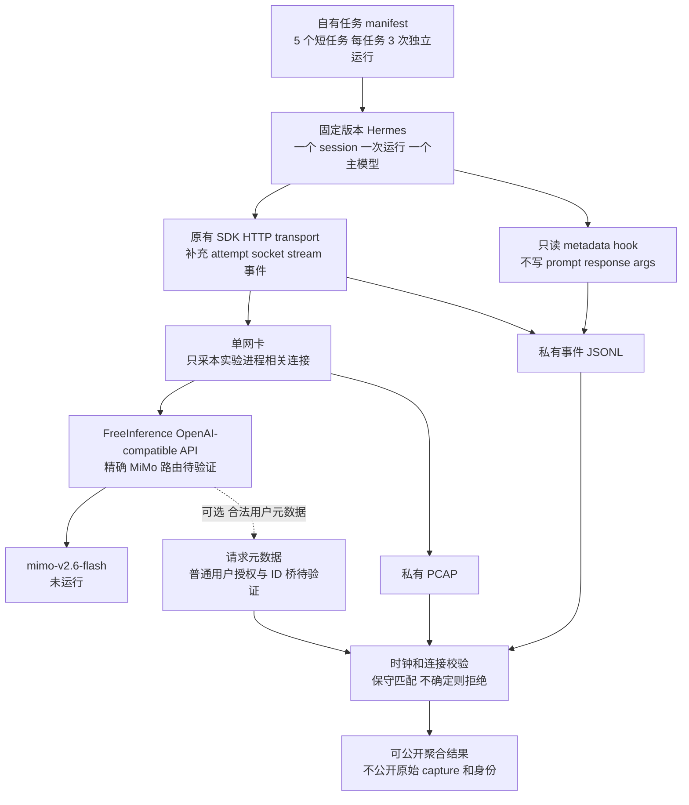
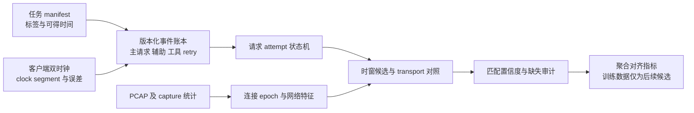
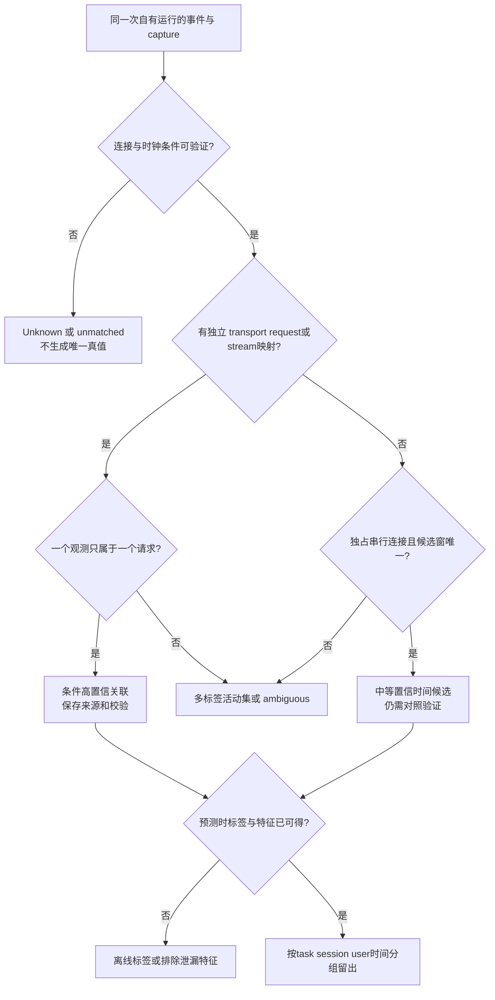

# Hermes–FreeInference–PCAP 最小验证实验

**当前结论：可设计并验证离线匹配逻辑，但尚不能宣称 Hermes + `mimo-v2.6-flash` 的真实配对实验已具备全部运行条件。**本次没有模型推理、Hermes 运行、Gateway 私有日志访问或 Agent PCAP 采集。已完成公共 HTTP 元数据检查和 11 个自建合成匹配检查，详见末尾。

MVP 的第一问题是“自有应用事件能否可靠对应自己捕获的网络观测”，不是先训练一个高准确率分类器。不依赖历史公开 FreeInference 数据冒充自己此次运行的 Trace。详细误差模型及历史 join 边界见 `trace_pcap_alignment.md`。

## 1. 启动门槛和当前证据

| 门槛 | 当前状态 | 未满足时的处理 |
|---|---|---|
| Hermes 官方 harness | 源码/文档 Verified；审查固定 SHA `b7db40d82568ea68ce321ac1ead3bfea354c7f56`，未安装/运行 | 先完成干净环境安装和 metadata recorder 的本地回调预演；不能称已跑 Agent |
| 精确模型 ID | 文档的 OpenAI-compatible base URL 是 `https://freeinference.org/v1`。2026-11-10T08:21:02Z 匿名 `GET /v1/models` HTTP 200，三项是 `bge-m3`、`deepseek-v4-flash`、`qwen3.6-35b`，**没有 `mimo-v2.6-flash`**；所读模型文档也未列该 ID [D1,L1] | 当前授权账户的精确 MiMo 路由和真实调用能力 Unknown；暂停该模型的真实阶段，不无说明改成其它模型 |
| 账户与计费授权 | 本次未读取或发送推理 key/JWT，未调用任何模型 | 后续须由研究者已有合法账户确认 access-filtered catalog、quota/费用约束；当前任务不启动付费推理 |
| 自己的 Gateway 元数据 | 当前源码有登录 JWT 保护的 `/user/recent-requests`；无认证实际 GET 返回 401 [G1,L1] | 可不依赖 Gateway，先以客户端 hook/transport 账本采对齐预演；不能称拿到了 Gateway 真实 Trace |
| Gateway 的共同 ID | 客户端 header ID、内部 request ID、SSE response ID 不同；DB 存在 response ID 桥，普通用户列表未暴露该桥 [G2] | 只有合法返回/导出实际验证映射后才纳入精确 join；admin/internal grant 权限不是普通 API key 权限 |
| 客户端 capture 能力 | 本次未验证可用 NIC/capture 权限与配置；真实 capture 未执行 | 在有权捕获自己流量的机器检查已有 `dumpcap`/`tcpdump` 能力；不调用未知提权脚本、不为此要求访问别人流量 |

匿名 catalog 的缺项不证明 MiMo 在所有账户/未来版本永久不支持；文档称认证目录依访问权限过滤。反过来，某历史 trace/demo 出现过 MiMo 也不证明今日 exact model ID 可调用。即使认证 catalog 列出，也只能证可发现性，实际推理成功还须单独测量。当前有源码/公开 GET 的门槛事实，授权目录和真实推理仍为 Unknown。

拟用的接口是 `POST https://freeinference.org/v1/chat/completions`：当前源码注册该 route 并使用推理 API-key 校验 [G3]；官方 headers 文档规定 API-key Bearer 认证 [D2]。这只确认通用接口形状，不确认该 endpoint 下 MiMo 的模型映射、上游 provider、tools/stream 能力或账户访问。没有发出此 POST；登录用户 metadata 的 JWT 也不能与推理 key 混用。

## 2. 最小拓扑



第一阶段只允许单个活动主请求，禁用或明确记录后台 titling、compression、vision、MoA、子 Agent、fallback、自动模型切换和外部工具网络。不是假定 Hermes 默认没有这些行为；必须在固定版本配置中逐项确认。禁用不了的辅助流量保留独立事件和标签，不能从 PCAP 随意删掉后宣称完整覆盖。

## 3. 应用事件从哪里来

### 3.1 优先使用官方 observer hooks

Hermes 文档和调用点已确认以下静态能力 [H1–H4]：

- `pre_api_request`、`post_api_request`、`api_request_error` 具有 session/task/turn/API request 身份以及时间、状态等字段；post 还传 `first_chunk_at`。
- `pre_tool_call`/`post_tool_call` 给工具逻辑边界；另有 session、subagent 生命周期。
- `pre_auxiliary_call`/`post_auxiliary_call` 另管辅助模型，主循环 API hooks 不能自动当作全部网络请求的清单。
- hook 包括经过清理的 `request`/`response`，也仍可能提供原始 `request_messages`/`conversation_history` 兼容字段。**“sanitized”不等于无 prompt 内容**；本实验禁止整体序列化 `kwargs`。

还有一项静态粒度风险：文档称 `api_request_id` 为 opaque provider-attempt 身份，但所审主循环在 retry loop 外分配 `api_request_id` 和 `api_start_time`，循环内可再次 build/send；pre hook 有 `retry_count` [H2,H3]。因此不能只按一个 ID 就断言恰好一个 HTTP attempt，也不能把同名 `started_at` 当作每次重试的独立 wire start。SDK 自身透明重试还需在 transport 观测。

建议 recorder 对每次 pre 回调生成本地递增 `attempt_seq`，保留来源 `api_request_id`、`retry_count` 和实际 callback receipt 时间；对 error/post 做状态机闭合，缺事件时标 orphan/Unknown。若 callback 因 fail-open 丢失，不能把 Agent 继续执行误当作日志完整。连接/stream/socket 映射必须通过 SDK/transport 补充；API hook 本身没有证明精确 socket 字节归属。

流式插件 observer 在所审版本使用异步工作队列，队满可丢最旧事件 [H5]。所以流式回调“被 recorder 收到”的时间不一定是 token/网络 chunk 产生时间。使用 payload 中明确定义的 event time 并记录队列丢失，否则只作低置信辅助；本次没有测得队列延迟。

只读回调接口示意（**设计片段，未在 Hermes 中执行**）：

```python
def register(ctx):
    ctx.register_hook("pre_api_request", on_pre_api_request)
    ctx.register_hook("post_api_request", on_post_api_request)
    ctx.register_hook("api_request_error", on_api_request_error)
    ctx.register_hook("pre_tool_call", on_pre_tool_call)
    ctx.register_hook("post_tool_call", on_post_tool_call)
    # 辅助/会话事件另按固定版本的官方注册接口补齐。

def on_pre_api_request(**event):
    # recorder 自己生成 local_attempt_id 并记双时钟；仅取固定白名单。
    write_metadata_only(
        event_type="api_pre",
        session_id=event.get("session_id"),
        task_id=event.get("task_id"),
        turn_id=event.get("turn_id"),
        source_api_request_id=event.get("api_request_id"),
        source_retry_count=event.get("retry_count"),
        source_started_at=event.get("started_at"),
    )
    # 不读取/写出 event['request']、messages、args、response、error正文。
```

以上不是现成可安装插件。下一轮需依据该版本 plugin manifest/加载文档实现并在假 context、本地受控 HTTP server 验证，才可启用 Hermes。不要用 `HERMES_DUMP_REQUESTS` 或通用调试日志替代 metadata recorder。

### 3.2 本地代理是可选的第二路径

若 transport 无可维护 hook，可在自己客户端上建立仅绑定 loopback 的 OpenAI-compatible metadata 代理，由其生成本地 UUID，记录入站/出站尝试、status、字节数量和双时钟，不持久化 Authorization、prompt、response、tool args 或完整 header。代理转发到已验证的精确 Gateway 路由。

代理会改变连接池、TLS fingerprint、H2 支持、缓冲和时序；它记录的边界也多了一跳。应分别标记 Hermes→proxy 和 proxy→Gateway 两条连接，网卡抓包通常只看到后者。此方案先证明“被该代理介导的实验可对齐”，不能把代理指纹识别成绩称为 Hermes 自然流量识别。需另设原生直连对照，并报告 instrumentation overhead。**本次没有实现或运行该代理**。

## 4. metadata-only 账本与共同身份

| 字段组 | 建议字段 | 用途与边界 |
|---|---|---|
| 自有实验身份 | `run_id, task_id, session_id, turn_id, local_attempt_id, attempt_seq` | 自己生成或保留 harness 显式字段，不解析 opaque ID 字符串作为语义；原始身份私有保存 |
| 父子关系 | `parent_session_id, parent_turn_id, tool_call_id, source_api_request_id, source_retry_count` | 区分子 Agent、并行工具和重试；一个工具不自动关联一个 socket |
| 事件时间 | `event_type, wall_ns, monotonic_ns, clock_segment_id, source_started_at/source_ended_at, label_available_at` | 接收时刻与源打点分列；双时钟转换和在线标签可得性 |
| 传输身份 | `connection_epoch, socket/process_scope, local_tuple, remote_tuple, protocol/ALPN, transport_attempt_id, stream_id`（实际可得才写） | 五元组还需连接 epoch；H2/H3 stream 不可由被动 TLS 包凭空恢复；NAT 前后 tuple 不能直接等值 join |
| 可选服务器桥 | `response_id, gateway_internal_request_id, verified_bridge_source` | 实际取得合法映射后才加入；header echo 单独记，不能当 internal ID |
| 状态与完整性 | `status_code, event_seq, recorder_drop_count, capture_drop_count, event_source` | 报告 orphan、missing、retry、异常退出；不写 error 原文或内容 |
| 控制条件 | pinned harness/model、协议、并发上限、网络条件、capture 配置、任务标签来源 | 作为实验控制/监督元数据，不能无意成为 network-only 模型输入 |

首次版本应包含 schema version、字段可空性和事件状态机。日志在本地私有目录，权限受限；公开仓库仅放 schema、代码、合成 fixture、汇总指标和检查过的少量日志。论文生产记录的匿名 ID 与本表自己的 ID 不是同一命名空间。

## 5. 具体执行步骤（以下均为下一轮计划）

1. **固定环境和目标。**保存 Hermes SHA、许可证、依赖 lock、Python/SDK/OS/capture 工具版本；独立 Conda prefix。使用官方仓库的常规源码安装路径，先审查依赖和构建命令，不执行网络 pipe-to-shell 安装器。记录直接/代理路径、API 协议、自动重试与辅助调用策略。
2. **只验证可发现性。**研究者在自己的授权会话中查看官方模型 catalog，核实 exact `mimo-v2.6-flash` ID、base URL、API mode、tools/stream 能力及费用条件。key 仅在本地安全注入、不进命令行/日志/CSV。未通过则记录阻断；可单独继续本地受控 HTTP 的 instrumentation 预演，但不称为 MiMo 或 FreeInference 推理。
3. **验证事件 recorder。**通过本地受控 HTTP server 模拟成功、SSE、retry、timeout、并发；检查每次 wire attempt 与 API span 的计数差、无内容落盘、序号完整性。保存事件/连接/stream 关系的精确 ground truth。该模拟的行为类别不是生产 Agent 行为结果。
4. **预检 capture 与时钟。**明确唯一 NIC、自己进程/命名空间范围、snaplen、timestamp type、offload、drop counters；记录 wall/monotonic 分段和已有时钟同步信息。不满足 capture 权限就停止真实抓包部分。
5. **少量独立任务。**建议 5 个自有、无敏感输入的短任务，各 3 次独立 session，限制运行/工具预算，例如本地读代码、修正一个小函数、运行本地测试、文本重构、数值校验。若选 SWE-Bench，固定实例/仓库版本和评估 harness，先一两个实例验证采集；不能以全部软件任务推断论文八类 intent 的覆盖。
6. **串行同步采集。**先启动 recorder/capture，记 run marker；一次一个 task、一个主模型、一个活动请求；任务结束后显式等待/关闭，保存原始私有产物校验值。TLS 握手/连接建立和任务间空闲也保留记录，不能按理想标签提前删掉。
7. **可选 Gateway 复核。**只在已有合法登录 JWT 或服务方正式授权导出下取得自己的行；核对 response ID/internal ID 桥、请求数、分页/写入延迟/重复与缺失。若取不到，明确“客户端配对验证，Gateway 侧未验证”；不使用内部 dispatch/admin 权限替代普通用户授权。
8. **对齐审查。**先做事件状态机、连接候选和误差区间；再做人工/transport ground truth 复核。多个可行候选保留 ambiguous，不强配最近邻；逐项解释 packet/session/request/burst 不同单元。
9. **并发压力。**串行完成后另开受控并发 2、长连接复用、一次 retry/失败、一个本地工具/一个受控远端工具的条件。验证系统能识别歧义并拒绝唯一标签，不能只展示最干净的一个窗口。
10. **仅在对齐足够后做探索分类。**预注册样本单位、标签生成时间、holdout、特征与基线。先区分 oracle 应用边界的已分段分类和 network-only 分段+分类；小样本结果只能描述该实验，不外推人群或多模型。

配置占位模板（**非已验证的可运行部署配置，不填真实 key 后归档**；基本 custom endpoint 结构来自 [H6]）：

```yaml
model:
  default: mimo-v2.6-flash
  provider: custom
  base_url: https://freeinference.org/v1
  api_key: <仅运行时在私有配置注入的合法凭据>
# 自定义 recorder、auxiliary、retry、tool 与并发配置须按 pinned 版本核实；
# 本报告不虚构尚未核实的 Hermes 配置键。
```

capture 命令占位示例（**未执行**；仅已有合法 capture 能力时使用；`<...>` 必须先改为自己实验值）：

```text
dumpcap -D
dumpcap -i <ONE_NIC> -f '<OWN_EXPERIMENT_CAPTURE_FILTER>' -s <SNAPLEN> -a duration:<MAX_SECONDS> -w <PRIVATE_RUN_DIR>/client.pcapng
```

网卡 endpoint filter 不等于进程身份过滤，尤其共享终点/CDN/后台请求时；优先实验命名空间/隔离进程并保留 socket 事件。单 NIC capture 可能仍含载荷/身份信息，不默认上传。上述命令没有承诺当前机器已安装工具或拥有权限。

## 6. 数据流与标签生成





网络特征仅取预先确定的包长、方向、IAT、突发统计和持续时间；明确 ACK/握手/重传/offload 处理。不得把 `model/provider/harness/tool_name/intent/token counts/request ID` 等应用元数据直接喂给 network-only 模型。终点 IP、SNI、API route 和代理指纹可能成为捷径；若研究行为识别，应通过同终点对照、跨条件留出/消融检验。

第一批只用一个 Hermes、一个模型，无法估计 harness 分类 Accuracy；15 个自有 session 也不是论文 8 类 intent 的充分数据。intent 若要标注，需自己任务清单或盲化人工方案，并明确它与论文 LLM few-shot 标签非同一个真值。FreeInference 历史 release 没有可直接用于重建 intent 的公开 prompt 文本。

## 7. 通过、失败与应报告指标

| 检查 | 报告量 | 可得出的结论 |
|---|---|---|
| 事件完整性 | 任务/API span/wire attempt 数、orphan/duplicate、retry/aux 覆盖、drop counters | recorder 是否足以作监督来源；不能只看 Agent 正常结束 |
| 时间误差 | 各打点的 residual 分布、P50/P95/max、offset 区间、clock steps | 该拓扑中的边界可辨识程度；不预设毫秒级目标已达成 |
| 连接与并发 | 每观测候选数、unmatched/ambiguous rate、transport 对照一致率 | 是否能唯一关联；H2/H3 失败说明时间法的条件边界 |
| Gateway 复核 | 授权可得性、ID 桥一致率、记录写入滞后/缺失 | 仅在真实取得合法自有行后评估；当前 Unknown |
| 标签质量 | granularity、label source、label available time、审查一致率 | 能否产出限定范围的监督标签；category/intent/行为事件不混用 |
| 分类探索 | group-held-out 指标与不确定区间、分段误差、混杂消融 | 只在采集充分后讨论；不得用一批相邻窗口随机切分虚报泛化 |

成功只证明“该受控、自有、记录完整的场景可生成一定置信度的标签”。如果精确 MiMo 路由不可用、用户 Gateway metadata 取不到、并发无法唯一关联或抓包不完整，按实际条件报告失败/Unknown，仍可留下有价值的误差证据；不能以替代模型、模拟数据或代理结果冒充原目标实验。

## 8. 本次真正执行的验证

| 实际执行 | 观察 | 范围 |
|---|---|---|
| `python scripts/alignment/check_public_gateway_metadata.py`，08:21:02Z | 匿名 `/v1/models` 200、合成 ID header echo true、catalog 3 项无目标 MiMo；匿名 user recent-requests 401 | 无 auth、无推理、未读用户 body；日志 `logs/alignment_public_http_checks.json` |
| `python scripts/run_logged.py --log logs/alignment_synthetic_checks --timeout 30 -- python scripts/alignment/synthetic_checks.py`，08:24:25Z | Python 3.12.14，退出 0，11 个合成 invariant 通过 | 自建 interval matcher；0 个真实 Agent runs/PCAP/model calls；日志 `logs/alignment_synthetic_checks.log/.json` |

合成测试涵盖同连接串行复用、重叠 H2 候选、独立 transport ID、一个观测含多 stream、时钟不确定性制造歧义、无关连接、缺连接键、迟到包不强配、边界弱标签和无效区间拒绝。它们是实现级检查，不能验证真实 Agent 行为、时钟同步或云端网络分类性能。

## 来源

- [D1] FreeInference [模型目录文档](https://doc.freeinference.org/models.html)、[quickstart](https://doc.freeinference.org/quickstart.html)、[公共 catalog](https://freeinference.org/v1/models)，2026-11-10 读取；[L1] 为本次 `logs/alignment_public_http_checks.json`。
- [D2] FreeInference [API Headers Reference](https://doc.freeinference.org/api_headers.html)，Authentication 与 X-Request-ID；2026-11-10 读取。
- [G1] Gateway 官网显示源码版本 `7f7585bc60a303f9dc8e2a0f219ab7f0b99f3255`：[user_routes.py](https://github.com/HarvardMadSys/hybridInference/blob/7f7585bc60a303f9dc8e2a0f219ab7f0b99f3255/apps/backend/serving/servers/routers/user_routes.py#L1279-L1388)、[JWT dependency](https://github.com/HarvardMadSys/hybridInference/blob/7f7585bc60a303f9dc8e2a0f219ab7f0b99f3255/apps/backend/serving/servers/deps.py#L349-L393)。
- [G2] ID 桥及权限区别见 `trace_pcap_alignment.md` §2，固定源链接 [G3–G8]。当前网站显示版本不证明历史部署同版。
- [G3] 同 Gateway 版本：[completions.py route 与鉴权](https://github.com/HarvardMadSys/hybridInference/blob/7f7585bc60a303f9dc8e2a0f219ab7f0b99f3255/apps/backend/serving/servers/routers/completions.py#L716-L741)。
- [H1] Hermes 固定版本 `b7db40d82568ea68ce321ac1ead3bfea354c7f56`：[observer-hooks.md](https://github.com/NousResearch/hermes-agent/blob/b7db40d82568ea68ce321ac1ead3bfea354c7f56/website/docs/developer-guide/observer-hooks.md#L72-L170)。
- [H2] 同版本：[turn_api_request.py](https://github.com/NousResearch/hermes-agent/blob/b7db40d82568ea68ce321ac1ead3bfea354c7f56/agent/turn_api_request.py#L60-L107)，包含 retry_count、内容字段和 started_at。
- [H3] 同版本：[conversation_loop.py，retry loop](https://github.com/NousResearch/hermes-agent/blob/b7db40d82568ea68ce321ac1ead3bfea354c7f56/agent/conversation_loop.py#L1577-L1606)、[ID/时间分配](https://github.com/NousResearch/hermes-agent/blob/b7db40d82568ea68ce321ac1ead3bfea354c7f56/agent/conversation_loop.py#L1767-L1771)。
- [H4] 同版本：[turn_response_intake.py](https://github.com/NousResearch/hermes-agent/blob/b7db40d82568ea68ce321ac1ead3bfea354c7f56/agent/turn_response_intake.py#L66-L107)，post 字段含 first_chunk_at。
- [H5] 同版本：[plugin_stream_hooks.py](https://github.com/NousResearch/hermes-agent/blob/b7db40d82568ea68ce321ac1ead3bfea354c7f56/agent/plugin_stream_hooks.py#L1-L60)，异步队列和 drop-oldest。
- [H6] 同版本：[integrations/providers.md](https://github.com/NousResearch/hermes-agent/blob/b7db40d82568ea68ce321ac1ead3bfea354c7f56/website/docs/integrations/providers.md#L1224-L1232)，custom OpenAI-compatible endpoint 配置结构。
