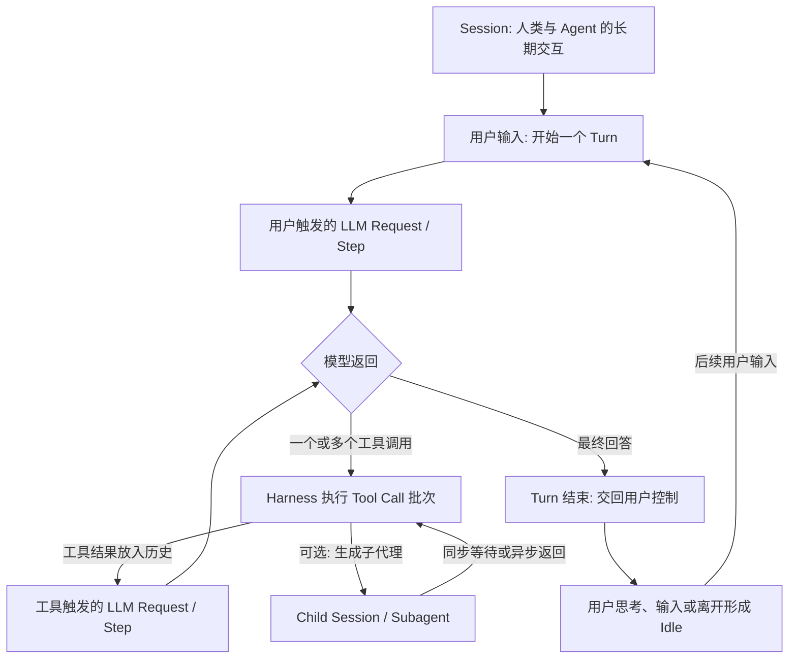

# FreeInference 论文完整阅读与实验声明分析

本文审计的对象是 **From Requests to Sessions: A Large-Scale Characterization of Human-Driven Agentic Workloads**。结论是：论文提供了真实生产环境中的 **Agent 应用层与 LLM Serving 工作负载证据**，尤其适合研究长期 Session、工具等待和上下文复用。它没有测量 Packet、TCP Flow、TLS Record 或 HTTP Stream，也没有建立 Agent 事件到 PCAP 的对应关系。其数据可帮助设计网络测量实验；能否训练网络侧分类器，需要额外的同步采集与标签验证。

此文件属于**论文来源事实与方法审计**，不宣称完成了论文数值复现。实际数据统计、代码覆盖及执行结果分别见本任务的 `reproduction_report.md`、`paper_code_coverage.csv` 等报告。下述模拟数值均为论文报告值，不是本任务运行结果。

## 阅读范围与证据版本

- 已读官方 PDF 全部 18 页：正文至 p13，参考文献从 p13 延续至 p18；本版本没有 Appendix。逐项清点得到 Figure 1–16、Table 1–7，独立清单见 `research_notes/paper_workload_characterization/inventory.json`。
- [官方论文](https://data.freeinference.org/pdf/paper/from-requests-to-sessions.pdf)，本地文件 SHA256：`0ab3b7968bb57f3edd27d7102cb48d99a23c72c0fcb42e6178f81bd8ba077c46`。本报告的页码为 PDF 页码。
- 作者：William Nixon、Muxin Tian、Yunjia Zheng、Haryadi S. Gunawi、Juncheng Yang。[PDF p1](https://data.freeinference.org/pdf/paper/from-requests-to-sessions.pdf#page=1)。论文 DOI、正式会议/期刊及权威发布日期在此次 PDF 内未核实，记为 **Unknown**；PDF 元数据日期不能代替发表日期。
- [官方网站](https://agent-traces.freeinference.org/)、[官方数据集](https://huggingface.co/datasets/harvardMadsys/freeinference_agentic_trace)、[官方代码固定版本](https://github.com/HarvardMadSys/freeinference_agentic_trace/tree/2b795dbf5eac490a7c081906fdce6cc7a184b7ef)。代码关联已经由任务整体核验；本文不以“论文描述了算法”推断“源码一定公开”。
- 事实分层：**Verified/source** 表示在上述来源直接读到；**Inference** 表示本审计的合理推断；**Unknown** 表示尚未得到证据。真实采集值、重建/归一化结果、LLM 标签和假设模拟必须继续分别处理。

## 研究问题及贡献边界

传统 LLM 工作负载研究多以单次请求、Token 长度和负载变化为单位；受控 Agent benchmark 又通常给一个任务后连续运行到结束。真实人类使用 Agent 时，同一任务存在多轮用户干预、长空闲间隔、反复复用的巨大上下文、工具等待、上下文改写以及子代理。因此孤立请求无法解释缓存需要保留多久，也无法说明用户等待主要发生在模型还是工具上。[§1–2、pp1–3](https://data.freeinference.org/pdf/paper/from-requests-to-sessions.pdf#page=1)。

论文的核心问题是：长期 Session 如何组成与增长；LLM、工具、用户空闲如何分配时间；Prefix Reuse 如何受时间间隔和 Context Mutation 影响；缓存保留与上下文管理有哪些成本取舍；SWE-Bench 是否代表人类驱动使用。它的主要创新是将较广泛生产流量重建为 Session，并结合工具、角色 Token 和块级复用信息分析 Serving 决策。[§1、§3、§6、§10，pp1、3、7–11、13](https://data.freeinference.org/pdf/paper/from-requests-to-sessions.pdf#page=3)。

对网络系统的直接价值在于资源调度、缓存生命周期和等待分解。对网络流量分类的价值是提供候选事件、标签层次、任务规模和混杂因素；“存在可区分的加密流量指纹”属于后续需要测量的假设，论文没有证明。

## 采集对象、规模及选择偏差

论文说明数据采集自 FreeInference 推理服务，对外路由的模型使用报告的时延数据；TTFT 可能包含内部缓冲或排队。工具在客户端 Harness 执行，服务端看到的是模型结果和后来重放的工具结果，不是精确的工具进程计时。服务提供本地计算与远端 API 路由的 12 个模型；整个平台每月超过 3M 请求和 500B Token，用户运行超过 100 种 Agent。研究只选最流行的人类驱动 Agent，Table1 caption 还说明过滤单请求 API 流量和其他 benchmark replay；不能将整个平台规模当作本论文实际样本。[§3、p3；§9、p13](https://data.freeinference.org/pdf/paper/from-requests-to-sessions.pdf#page=3)。

| 项目 | 论文/官方声明 | 解释边界 |
|---|---|---|
| 时间 | 3.7 个月；固定 README 给出 16 周，2026-05-17 至 2026-09-05 | 完整周界限和时区仍由实际数据检查；不是连续网络抓包时长 |
| 用户 | README 为 267 accounts | 不代表随机人群；论文脚注说明只采集预先明确同意研究收集与分享的用户 |
| Session | 12,002 | Table1 含 SWE-Bench 1,035；相减得人类部分 10,967，是本审计算术值 |
| LLM Request / Tool Call | 1,186,582 / 1,213,347 | 请求和工具调用是不同事件，不等于网络 Flow 数 |
| Token | Input 209.2B、Output 552.5M、Cached 197.1B | Tokenizer/Provider 计数，不等于传输字节 |
| Harness | 13 种人类 Harness，加 1 个 SWE-Bench 类别 | Table1 有 14 行；除明确说明外，正文分析排除 SWE-Bench |

证据：[Table1、p1](https://data.freeinference.org/pdf/paper/from-requests-to-sessions.pdf#page=1)、[§3及同意收集脚注、p3](https://data.freeinference.org/pdf/paper/from-requests-to-sessions.pdf#page=3)、[README固定 SHA L24–L48](https://github.com/HarvardMadSys/freeinference_agentic_trace/blob/2b795dbf5eac490a7c081906fdce6cc7a184b7ef/README.md#L24-L48)。README 的精确日期属于额外发布说明，不能说全由论文给出。

Table1 各类别 Session 数：Hermes 3,953、OpenCode 1,733、Pi 1,499、SWE-Bench 1,035、Kilo 797、Codex 763、Oh-My-Pi 719、Claude Code 639、Copilot 295、Zcode 197、OpenClaw 189、Cline 86、Zoo 75、OpenHands 22。明显不均衡；训练分类器时不能只报微平均 Accuracy。[Table1、p1](https://data.freeinference.org/pdf/paper/from-requests-to-sessions.pdf#page=1)。这不证明任何具体类别具有网络指纹；模型路由、任务、用户和 Session 大小均可能混杂 Harness 标签。

**必须区分内部日志与发布数据。** Table3 的内部字段包括 `messages`（Prompt 与 Response 文本）。公开 README 明确去除 message/prompt/tool result text 与原始 ID。不能因 Table3 有正文，认定公开 Parquet 足以重新生成依赖用户 Prompt 的所有标签。[Table3、p3](https://data.freeinference.org/pdf/paper/from-requests-to-sessions.pdf#page=3)、[README固定 SHA](https://github.com/HarvardMadSys/freeinference_agentic_trace/blob/2b795dbf5eac490a7c081906fdce6cc7a184b7ef/README.md#L24-L48)。

**Inference：** 数据存在自愿用户选择、开放服务选择、热门 Harness 选择、模型与路由配置差异等偏差。论文不限制使用方式，也明确其异质工作负载不一定代表受控平台。[§9、p13](https://data.freeinference.org/pdf/paper/from-requests-to-sessions.pdf#page=13)。没有依据将其推广为全部 Agent、商业用户或所有任务类型的总体分布。

## Agent 实体、触发关系与时间

依据 [§2.1 / Figure1、p2](https://data.freeinference.org/pdf/paper/from-requests-to-sessions.pdf#page=2)：

| 实体 | 定义与关系 | 不能直接等同的网络对象 |
|---|---|---|
| Session | 人类与 Agent 的端到端交互，包含一个或多个 Turn，并积累上下文 | TCP Flow、单条 TLS 连接 |
| Turn | 从一次用户输入开始，经过自主 LLM–Tool 循环，到最终回答并交回用户控制 | 一个 Burst、一次 HTTP 请求 |
| Step | 一个模型请求；首个为用户触发，后续通常因工具结果触发 | 一个 Packet 或固定数目的 Packet |
| LLM Request | Step 的服务交互；输入历史，输出文本或工具调用，可能流式返回 | 单一独立连接 |
| Tool Call | 模型要求 Harness 执行工具；一次 Response 可包含多项并行工具 | 必然存在的外网请求；读文件/本地 shell 也属于工具 |
| Subagent | 工具触发的子 Agent/子 Session，可同步等待或异步运行 | 新建连接或独立终端流量的必然标签 |

图中逻辑层次不规定连接、Packet 或时钟对应。用户 Idle 可使 Session 很长；不代表连接一直存活。一个 Request 可以有流式多次返回，一个连接也可能承载多个并发 Request；论文没有给出其 HTTP/2/3 复用测量。

## Session 重建：论文方法与验证的准确含义

推理 API 无状态，多数 Harness 不发送显式 Session ID。Strict Prefix Matching 要求保留前次完整输入前缀，会在 Harness 修改早期上下文时错误分裂。作者改用“前次 LLM 输出在后续请求历史中重放”的关联：工具调用响应使用 Tool Call ID；其他情况匹配助手消息内容。作者不施加固定 inactivity cutoff，旨在保留长间隔后的复用；研究者可在分析时再设界限。[§3、p3](https://data.freeinference.org/pdf/paper/from-requests-to-sessions.pdf#page=3)。

论文在提供显式 Session ID 的 Harness 子集验证，**95% 重建 Session 与 Harness Session 一对一匹配**。大部分不一致来自 Harness 在空闲后重新生成 ID，而逻辑对话仍延续。这个数字不等于“全部用户的 Session 真值准确率 95%”，也不验证 Turn、Subagent 边或网络标签。论文没有给出验证子集大小、各 Harness 误差率、False Merge/False Split 混淆矩阵及人工 adjudication。[同上](https://data.freeinference.org/pdf/paper/from-requests-to-sessions.pdf#page=3)。

**待源码/数据验证的问题：** 重复助手输出碰撞如何处理；工具 ID 是否在账户范围内唯一；跨用户/跨 Harness 的匹配范围；历史裁剪时怎样延续；子代理如何定位父 Session；重试和并发如何定序。这些属于研究审计问题，不能将它们写成已确认缺陷。源码是否公开、公开的是重建还是重建后发布管线，由独立 `session_reconstruction.md` 回答。

## 九类实验逐项分析

### 1. Session 结构与持续时间

**问题 / 输入 / 特征：** 生产人类 Session 中有多少用户、工具及 LLM Step，Turn 和 Session 各持续多久。使用重建层次与时间戳；排除 SWE-Bench。**方法：** Session 计数和时长 CDF；Turn 内执行与跨 Turn 空闲分别解释。[§4.1、pp3–4；Figure2a–b、p4](https://data.freeinference.org/pdf/paper/from-requests-to-sessions.pdf#page=4)。

**论文结果：** Session 中位用户 Step 为 4、工具 Step 为 36、LLM Step 为 42；这些是各自分布的中位数，不能按中位数相加重建单条 Session。Turn 中位约 60.6s（文中约一分钟），Session 中位 30.2min；最长 10% 超过 7.7h。长 Session 主要由跨 Turn 空闲拉长。

**结论 / 范围：** 一次 Agent 任务应以长期状态轨迹而非孤立请求分析。**局限：** Session 是算法重建；缺少固定空闲截断使跨日逻辑对话仍可能归一；不能由时长推断连接寿命或 PCAP 完整性。

### 2. Token 数量、上下文增长和费用

**输入 / 特征 / 方法：** Request 的 Input、Cached Input、Uncached Input、Output Token、角色 Token 和 Step 位置；采用 CDF、按 Step 的中位/P25–P75 趋势和 Token/成本份额。成本只使用报告 cache usage 的请求，并套用论文给出的 Claude Fable 5 单价：Cached Input $1/M、Uncached $10/M、Output $50/M。[§4.2 / Figure2c–d、Figure3，p4](https://data.freeinference.org/pdf/paper/from-requests-to-sessions.pdf#page=4)。

**论文结果：** 输入中位 129.1K Token，但 Uncached 中位 491，Output 中位 227。早期 Uncached 约 10K，随后降至约 1K 并继续下降；缓存前缀前十步约每步增 2.5K，百步以后约 330。Assistant+Tool 历史占比从第十步的 32% 升至一千步的 92%；长 Session 中工具历史被裁剪，助手历史持续积累。Cached Input 占所选请求 Token 总量 97.4%，但因反复读取仍贡献模型费用的 72.9%；Uncached 与 Output 分别为 17.4% 和 9.7%。

**解释 / 局限：** 数据支持“大上下文重复使用、新增内容很小”。费用是价格模型，不是实际账单；Token 数不是编码后请求长度、TLS 密文长度或 KV 内存实测值。读缓存通常节约服务端计算，不保证客户端少发送同样的上下文。

### 3. LLM 时延、TTFT 与 Session 时间组成

**输入 / 特征 / 方法：** Request TTFT、完成时延、Provider Cache Token 和时间戳。外部路由模型以冷长上下文 miss 估计纯 Prefill 吞吐，再从 TTFT 减去估计 Prefill；剩余称 Queueing，论文明确包含其他 Serving overhead。客户端工具时延由服务侧间隔估计。速度提升分析独立将某一阶段吞吐翻倍，排除用户 Idle，且每段工具间隔最多按十五分钟计。[§4.3、pp4–5；Figure4、p5](https://data.freeinference.org/pdf/paper/from-requests-to-sessions.pdf#page=5)。

**论文结果：** Minimax-M2.7、Kimi-K2.7-Code 估计纯 Prefill 约 8K Token/s；典型 Uncached 不足 1K，因此纯 Prefill 往往不足 0.1s。中位 TTFT 约 4s，Decode 约 1–3s。平均 Session 时间占比：User Idle 50.3%、Tool 21.7%、Decode 18.1%、Prefill 9.9%。将 Tool / Prefill / Decode 吞吐各自翻倍的模型加速比分别是 1.38× / 1.09× / 1.16×。

**结论 / 局限：** 请求 TTFT 的主要开销与 Session 的主要时间来源不同。Queueing 不是队列内部探针；有效 Tool latency 不是精确客户端进程耗时；翻倍结果属于反事实，未部署真实优化。对两个外部路由模型的图不能推断全部模型具有相同绝对时延。

### 4. Tool 频率、类别、时延及输出

**输入 / 特征 / 方法：** Tool 名称、Shell command、结果 Token、Outcome 与相邻 LLM 事件。作者按预期功能归一化；复合命令用最后一个命令，管道用第一个。有效时延从 LLM 响应完成到工具结果回传，减去估计 RTT。Table5 给 Call/Session/Token/Time/Fail/Batch share，Figure5 给分位及均值。[§5、pp5–6；Table4–5；Figure5](https://data.freeinference.org/pdf/paper/from-requests-to-sessions.pdf#page=6)。

**论文结果：** Native 47%、Shell 53%。Read 16.3%、Edit 12.2%、Interpreter 12.4%、Search 11.2%、File Ops 9.0% 贡献超过六成调用；Read 贡献 33.9% 结果 Token。Interpreter 占 12.4% 调用却占 16.9% Tool wait；Ask User 仅 0.4% 调用却占 5.8% Tool time。总体失败率 3.3%。本地操作中位约 0.9–1.7s，Interpreter 2.8s、Build 7.2s、Wait 11.7s、Subagent 13s（均值约 100s）；Subagent 和 Ask User 的 P95 分别约 8.9 和 13.3min。Read 结果中位 441 Token，Edit/Write 通常低于 50；多类存在长尾。

**解释 / 局限：** 类别内方差很大，类别不能充分预测时延。功能归一化是规则标签，不是八类用户意图；Shell 中 Network 类也不能覆盖全部外网行为。工具等待可能包含调度、用户设备或客户端网络开销，不能拿它作为 PCAP 中某段静默的真值长度。

### 5. Tool 批处理与 Subagent

**输入 / 特征 / 方法：** 单次 LLM Response 发出的工具批次、类别混合、父子 Agent 关系、同步 fanout 组内时间。批处理对照将串行所需额外 LLM 回合计入投影；子代理比较最慢/最快或中位时延，按 work-based、role-based 组别分析。[§5.2、pp6–7；Table6、p6；Figure6–7、p7](https://data.freeinference.org/pdf/paper/from-requests-to-sessions.pdf#page=7)。

**论文结果（先照录纸面口径）：** 66.9% Session 出现过批处理，33.1% 从不批处理。Table6 将 1/2/3/4+ Tool 的 84.5%/8.7%/3.5%/3.3% 称为每请求分布；公开实现实际上按 Call 行加权，不能直接解释成请求概率，见下方补充审计。纸面批处理请求中 71.3% 同类、28.7% 混合；固定仓库发布表数值不同，也见下方。Subagent 出现于 10.4% Session；fanout 为 1/2/3/4+ child 的比例 80.6%/9.2%/5.1%/5.2%（四舍五入）；同步 67%、异步 33%。批次 P90 时延在不同宽度下约 14–28s，串行投影随宽度增长。角色分工组更容易受 straggler 影响。

**数值口径提醒：** Figure7 caption 用典型最慢约为最快两倍，正文提到超过三倍的情况，导言还描述超过五倍的尾部。它们未必矛盾，但不是一个可合并的统一分位数；复现时应核对分母、同步组过滤及分位。**局限：** 这些是所观测调用和推断父子关系上的比较，不是随机分配串/并行策略的受控性能实验；工具数和网络连接数没有一一对应。

### 6. KV Cache Prefix Reuse 与保留时间

**测量部分：** 按请求间隔、Provider 和间隔来源比较 Provider 报告的缓存命中。普通 Tool gap 占 92.7%，中位 1.8s；其 P90 为 17.2s，Ask User / Subagent / User Idle 的 P90 分别为 6.3min / 6.2min / 17.4min。普通 Tool 之后平均命中 97.5%，User Idle 之后 84%。15–30min 间隔对应约 58% 命中，一小时以上约 18%。匿名 Provider A–D 的保留曲线有明显差异。[§6.1 / Figure8，pp7–8](https://data.freeinference.org/pdf/paper/from-requests-to-sessions.pdf#page=8)。

**模拟输入 / 方法：** 重放重建请求序列，使用 16-Token 的链式哈希块模拟 Prefix Cache、TTL、Reusable/Dead block 和假定价格。比较 Prefill 相对无限 TTL 下限、平均保留存储，以及 API 和基础设施成本。[§6.3、pp9–10；Figure10–11、p9](https://data.freeinference.org/pdf/paper/from-requests-to-sessions.pdf#page=9)。

**论文模拟结果：** TTL 为 15min / 30min / 1h / 6h / 1day 时，Prefill 比无限 TTL 下限高约 60.9% / 35% / 21% / 7% / 1%；1h 和 1day 平均存储分别为 15min 的 2.1× 和 25.6×。API 成本在 30min 已距最优不足 4%；假定基础设施成本在 15min 最低。一天 TTL 时未回收 dead blocks 可极大超过活跃状态。生命周期 `mutate`/`end` 信号在 Figure13 caption 中使一天 TTL 的 dead blocks 约降 36×；p11 正文称 accumulated storage 最多降 36×。两处口径应在重算时核对，不能直接当作总缓存容量降低 36×。[Figure10–13、pp9–11](https://data.freeinference.org/pdf/paper/from-requests-to-sessions.pdf#page=9)。

**假设与局限：** 基础设施模型设重计算 $1/M Token、存储 $30/M Token-days、70B GQA FP16 的 KV footprint 为 320KB/Token。这不是网络字节，也不是本任务机器的内存实测。Provider A–D 的真实策略不可由曲线唯一确定；TTL 实验不是部署到这些 Provider 后的试验。十五分钟是该成本假设下的折中，不是对全部 Agent 的普遍最优定理。

### 7. Context Mutation 与上下文管理反事实

**输入 / 特征 / 方法：** 相邻 Step 的块级前缀、角色/工具定义位置及上下文改写类别；比较 Append 与 Mutation 的比例和命中，按无限保留模拟归因 fresh prefill。[§6.2、pp8–9；Figure9、Table7、p8](https://data.freeinference.org/pdf/paper/from-requests-to-sessions.pdf#page=8)。

**论文结果：** 96% Step transition 为 Append、4% 为 Mutation；56.4% Session 有 Mutation。用户触发步骤仅占 6.4% 全部步骤，却占 35.4% Mutation 步骤。无限 TTL 下 Mutation 贡献 62.5% fresh prefill。系统 Prompt 与 Tool Definition 变更分别只占 0.74% 与 0.40% 步骤，却贡献 26.9% 与 13.9% Prefill；其他列见原 Table7。各类“出现于多少 Session”可重叠，不能求和当互斥类别分布。

**反事实：** Figure12 假设 Cached-read 价格由 $1/M 向零下降时，减小上下文的 Mutation 按线性比例减少，并保留至多 1M Token。移除这种缩减可因上下文变长反而增加 Prefill，十五分钟 TTL 最高约 +5%，五分钟最高约 +10%。无限 TTL 下要到约 $0.05/M 的读价，额外读量才可能被 Prefill 节省抵销；有限 TTL 下即使读缓存免费，miss 成本仍可抵销收益。[§6.3–6.4 / Figure12，p10](https://data.freeinference.org/pdf/paper/from-requests-to-sessions.pdf#page=10)。

**结论 / 局限：** 很少的早期上下文修改可破坏长前缀，Context Reduction 不一定有害。62.5% 是无限保留归因模型，不能直接说真实服务中 62.5% Prefill 由 Mutation 导致；价格引起用户/Harness 行为线性变化是设定，没有价格随机试验。网络研究可用 Mutation 作为应用侧候选标签，但论文没有证明它在加密流量中可观测。

### 8. Human-driven 与 SWE-Bench 比较

**输入 / 特征 / 方法：** 生产人类与一个 SWE-Bench replay，比较 Turn/Session 时长、Input/User Prompt Token CDF、TTL 模拟及归一化 Turn 进度中的工具轨迹。工具合并为八组，以便与只用 Shell 的 benchmark Agent 比较。[§7、pp11–12；Figure14–15、p11](https://data.freeinference.org/pdf/paper/from-requests-to-sessions.pdf#page=11)。

**论文结果：** SWE-Bench / Human Turn 中位为 188s / 61s，Session 约 192s / 30min，Input 25.4K / 129.1K，用户 Prompt 约 1.4K / 42 Token。SWE-Bench 单次连续任务的 Turn 更长，但没有后续用户 Idle，整个 Session 更短。其五分钟 TTL 已距无限保留下限不足约 3%，人类十五分钟仍高约 61%、需约一天才能覆盖几乎全部复用。本文比较中 SWE-Bench 未出现人类式 Context Mutation。工具轨迹上，benchmark 先 Read/Search 再 Execute/Build/Test/Git；人类较多样、阶段性较弱。

**结论 / 局限：** 单一 benchmark replay 会低估人类 Session 的长期状态与保留需求。差异受任务、Harness、工具限制、模型和运行协议共同影响；不能作“人类驱动本身导致某个性能值”的因果结论，也不能用 SWE-Bench 成功代替所有真实 Harness 的验证。

### 9. 用户意图随 Turn 变化

**输入 / 特征 / 方法：** 从随机 1.8K Session 取约 10K Turn，使用 LLM 并给 few-shot 示例，对用户 Prompt 分成八类。Figure16a 为按 Turn 的类别份额，16b 为相邻 Turn 转移矩阵。[§7 / Figure16，p12](https://data.freeinference.org/pdf/paper/from-requests-to-sessions.pdf#page=12)。

| 类别 | 论文定义概要 |
|---|---|
| Create | 开始新工作 |
| Extend | 增加功能或范围 |
| Refine | 修改已有工作 |
| Debug | 处理失败 |
| Explain | 寻求理解 |
| Steer | “继续”“是”等引导/确认 |
| Setup | 配置环境 |
| Other | 其余请求 |

**论文结果：** Create 占第一 Turn 的 35%，随后明显下降；第一轮之后 Steer、Refine、Extend 合占 46%。Debug/Explain/Steer 等在相邻 Turn 具有局部持续性。作者提出这种模式或可帮助 Harness 识别任务边界，但没有在论文中验证一个已部署的任务边界识别器。

**关键缺口：** 论文没有报告标注模型名称/版本、完整 Prompt、few-shot 样例、seed、人工复核流程、标注准确率或一致性。随机 Session 抽样不自动消除 LLM 标签偏差。用户意图和 Tool Category 是不同粒度和不同来源；不应互相替代。公开 Prompt 正文缺失意味着仅凭匿名元数据不能忠实重跑基于原 Prompt 的标注。是否存在另发标签/代码由公开 Schema 和源码审计确定；论文描述本身不能证明已经发布。

## 补充：与固定公开实现交叉检查后的口径限制

以下是阅读公开源码和已发布统计表得到的事实，仍不是本任务重算成功的声明。独立复现审查将继续核对实际运行结果。

- **人类样本的选择条件比“过滤单请求 API”更强。** [`export/sessions/chains.py` L23–24、L89–96](https://github.com/HarvardMadSys/freeinference_agentic_trace/blob/2b795dbf5eac490a7c081906fdce6cc7a184b7ef/export/sessions/chains.py#L23) 要求人类至少两次 user turn 与一次 tool turn，SWE-Bench 只需 tool turn。它也会排除只有一次用户输入、但含多次模型/工具步骤的 Agent 任务。**Inference：** 该筛选有利于选中跨轮长期 Session，限制 Human/SWE Idle 与时长差异对所有 Agent 任务的代表性；效应大小尚未验证。
- **Harness 识别优先级不同。** 论文 §3 说有 User-Agent 时用其识别，否则用 System Prompt；[`harness.py` L64](https://github.com/HarvardMadSys/freeinference_agentic_trace/blob/2b795dbf5eac490a7c081906fdce6cc7a184b7ef/export/log_records/harness.py#L64) 实际先看前六条 System/User 消息、前 20K 字符中的最早识别短语，再回退 User-Agent。冲突情况下的实际标签影响 Unknown。
- **Table6 批次宽度分母不同。** [`paper/metrics/tools.py` L148–169](https://github.com/HarvardMadSys/freeinference_agentic_trace/blob/2b795dbf5eac490a7c081906fdce6cc7a184b7ef/paper/metrics/tools.py#L148) 明确按 Call 份额，三调用请求计三次，不是请求去重后的概率。固定版本 [`figures/v1/tools/batching_profile.csv`](https://github.com/HarvardMadSys/freeinference_agentic_trace/blob/2b795dbf5eac490a7c081906fdce6cc7a184b7ef/figures/v1/tools/batching_profile.csv) 同类/混合为 64.017%/35.983%，不同于 PDF Table6 的 71.3%/28.7%；其原因尚未确认。
- **Tool 统计的有效样本有限定。** [`overview_table`、`latency_by_category`](https://github.com/HarvardMadSys/freeinference_agentic_trace/blob/2b795dbf5eac490a7c081906fdce6cc7a184b7ef/paper/metrics/tools.py#L82) 的 Time 份额与 Figure5 latency 只看单调用请求；Fail 只看 Outcome 非空的调用；Result Token 分布只看有匹配结果的调用。不能将这些数值直接解释成包含全部并行调用的精确总耗时或所有调用的真值失败率。
- **公开有效时延路径未见显式 RTT 扣除。** [`tools.tool_waits`](https://github.com/HarvardMadSys/freeinference_agentic_trace/blob/2b795dbf5eac490a7c081906fdce6cc7a184b7ef/paper/metrics/tools.py#L23) 调用 [`turns.waits`](https://github.com/HarvardMadSys/freeinference_agentic_trace/blob/2b795dbf5eac490a7c081906fdce6cc7a184b7ef/paper/metrics/turns.py#L45) 计算相邻 Request 的 start−previous end。论文 §5 说扣除估计 RTT，但这个公开计算没有该项。私有原始记录是否已作校正 Unknown，故不能据此宣称与纸面时延定义严格等价。

## 全部编号对象与覆盖检查入口

| 论文对象 | PDF 页 | 内容 / 证据类型 |
|---|---:|---|
| Fig1 | 2 | 执行层次；概念图 |
| Fig2–3 | 4 | Session 结构、Token、增长；2d 为模型费用 |
| Fig4 | 5 | TTFT/Decode、时间组成；4d 为吞吐反事实 |
| Fig5 | 6 | Tool 有效时延与结果 Token |
| Fig6–7 | 7 | 批处理与 Subagent straggler；含串行投影 |
| Fig8–9 | 8 | Cache hit/gap 与 Mutation |
| Fig10–11 | 9 | TTL、存储和费用模拟 |
| Fig12–13 | 10 | 价格响应与生命周期信号反事实 |
| Fig14–15 | 11 | SWE/Human 比较；14e 为 TTL 模拟 |
| Fig16 | 12 | LLM few-shot 意图标签统计 |
| Table1 | 1 | 数据与 Harness 规模，包括 SWE-Bench |
| Table2 | 2 | 与已有 Trace 的文献比较；非原始数据实验 |
| Table3 | 3 | 内部生产日志字段；不等于发布 Schema |
| Table4 | 5 | Shell 类别命令示例；非待执行脚本 |
| Table5–6 | 6 | Tool 概况；Batch/Subagent 概况 |
| Table7 | 8 | Mutation 分类与无限 TTL Prefill 归因 |

该表只证明已读与清点；“对应代码完整”“从公开输入可重算”“数值一致”必须在覆盖矩阵中逐项另行成立。出版图已存在，也不等于原始计算、标注和模拟输入全部可从公开材料恢复。

## 真实测量、推断与模拟不得混写

| 层次 | 例子 | 可作出的结论 |
|---|---|---|
| 服务侧测量/Provider 报告 | 请求时间、TTFT、输入/输出/缓存 Token、模型元数据 | 指定来源与记录语义下的生产观测 |
| 重建/规则推断 | Session、Turn/Trigger、Harness 推断、Tool Category、Mutation、Subagent 关联 | 依赖规则与重建验证；不是天然真值 |
| 间接时延估计 | Queueing residual、有效 Tool latency | 服务侧估计；不能当内部队列或工具进程计时 |
| LLM 辅助标签 | 八类用户意图 | 模型输出标签；缺验证时不声称人工真值 |
| Trace-driven 模拟 | TTL、Prefill floor、Dead block、成本 | 特定模型/假设下的反事实；不能声称已经部署并达到这些性能 |
| 后续研究设想 | 加密 Agent 流量识别、PCAP 标签、调度优化 | 需要另行收集与验证，当前论文未证明 |

## 对毕业设计的证据支持判断

1. **已确认：** 论文提供多 Harness、长期 Session 和工具/上下文行为的生产证据。它比只看请求数量更适合指导采集任务与分层标签设计。
2. **已确认：** 采集在推理服务侧，缺精确客户端工具计时、网络包、连接/Stream 对应和时钟误差分析。它没有直接回答加密网络流量可识别性。
3. **合理推测：** Harness、User/Tool Trigger、Mutation 与 Subagent 可作为受控同步实验的候选标签；应该先验证标签质量与事件可对齐性，再测网络侧可分性。
4. **尚未验证：** 这些标签是否能从仅包长/方向/IAT/突发中学习，及是否跨任务、模型、用户、Provider 泛化。Table1 的不平衡和实际路由差异需要在分组划分中控制。
5. **明确边界：** 独立采集的新 PCAP 与历史公开 Trace 没有共同实验事件，不能靠相近日历时间或同一模型名可靠配对。最小可行路线是为自己的同一次运行同时记录客户端 Request 事件、Harness 事件和 PCAP，并检验时钟与多路复用误差；具体方案见本任务对齐/MVP 报告。

下一轮最先值得验证的不是大规模训练分类器，而是：单 Harness、单模型、少量短任务中，能否对**同一次请求**建立可信的应用事件—连接/Packet 时间映射，给出误配率与不确定窗口。若成功，只证明受控条件下可生成可靠监督样本；还需要独立测试网络特征是否可分类。若失败，可排除把仅时间窗口当作可靠标签的简单方案，指导增加客户端 Hook、受控代理或请求/Stream 映射机制。
