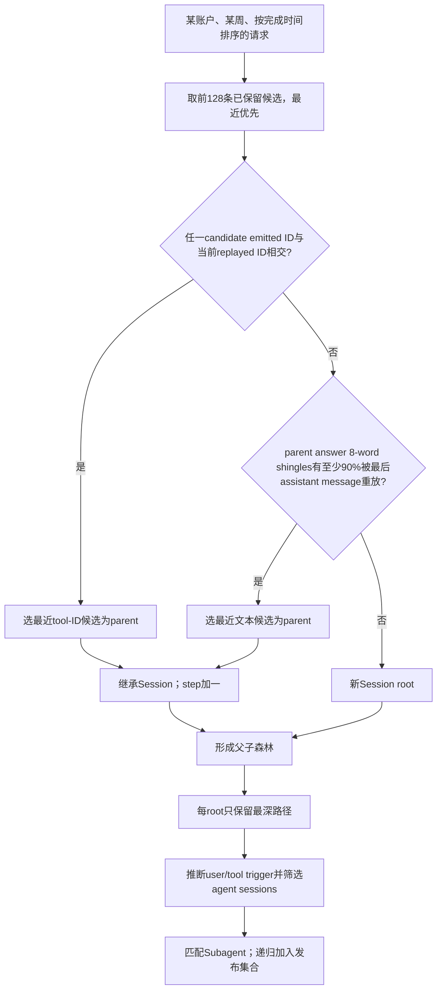

# Session 重建与标签生成审计

审计 commit：`2b795dbf5eac490a7c081906fdce6cc7a184b7ef`。范围：论文 §2–3、§7、§9（PDF p2–3、p11–13），官方 README、公开 schema、`export/sessions/`、harness/tool/privacy 代码。本文件的 **Verified** 表示固定源码或论文文本可核对；**Unknown** 表示证据不足。此处没有执行私有生产日志重建，也没有重测论文的 95% 正确性。

## 1. 为什么重建而不是读取 session ID

论文 §3（p3）说明推理 API 无状态，多数 harness 不发送显式 session identifier。Strict Prefix Matching 要求新请求完整保留旧输入为前缀；system prompt 改写、tool definition 变化、注入、历史删减和 compaction 都可能破坏前缀，即使对话仍连续。作者改用之前模型输出在后续输入中的重放信息。**当前 trace 仓库源码公开了这种链接算法，但不提供原始输入正文。** 匿名发布的 `session_id` 是重建结果的假名，不是客户端原始会话 ID。[P3] [C-SIGNALS] [C-LINK] [C-PSEUD]

需区分时间版本：另行发现的当前 Gateway 实现可读取客户端声明的多种 session header/body 形式并写 metadata；这不证明历史所有 harness 曾提供 ID，也不改变当前 trace export 使用 replay 重建的事实。当前 Gateway 与历史采集的部署关系 Unknown，详见 `architecture.md`。[G-START]

## 2. 从日志到主链的实际算法

| 阶段 | 当前 SHA 的具体规则 | 定位 |
|---|---|---|
| 筛选 | 请求需 status 200、有效 request ID/完成时间、非排除账户、可识别 harness；其余计数但不进入 linking | `extract.py:54–73` |
| 提取 output signals | 解析模型输出 tool-call ID；可见回答分成 8 个连续词的 shingles；短于 8 词且有 call 时附加 call name/arguments；仅前 8,000 字符 | `signals.py:27–67` |
| 提取 replay signals | 只读后续请求输入里**最后一条 assistant message**的 ID 和文本；不搜索全部历史 assistant 消息 | `signals.py:70–98` |
| ID 归一化 | 去非字母数字字符；支持部分 `toolu` replay shim；只有前部至少 12 字符的 `_<digits>` 后缀才可去除匹配 | `call_ids.py:12–49` |
| 排序/分组 | 单周请求按 `(end_ms, request_id)` 排序，再按账户分组；模型/harness/provider 不作为链接必须相同的条件 | `link.py:88–99` |
| 候选 | 仅该账户之前 128 条**已保留**请求，倒序最近优先；无秒数或分钟数阈值 | `link.py:77–85` |
| 选 parent | 先遍历整个候选窗口查任一 tool-ID 交集；没有 tool-ID match 才查文本；文本需 parent 的 shingle 集合至少 90% 出现在 replay 集合 | `link.py:53–74` |
| 无 parent | 新 root，原始 session ID 等于 root request ID；child 继承 parent session，step=parent.step+1 | `chains.py:55–67` |
| 主链 | 从 root 到最深后代的一条路径；最深并列按更晚 end、再更大 request ID 选；其他旁支不发布 | `chains.py:70–77`; `release_sessions.py:225–233` |
| user/tool step | tool-ID link 一律 tool；text link 且新增内容是 tool result/已识别工具文本则 tool；其余 user | `chains.py:80–86` |
| agent session | 常规至少 1 个 tool step、2 个 user step；`eval:swe-bench` 只需至少 1 个 tool step | `chains.py:89–95` |
| release population | 合格 agent session 加其递归匹配的所有 child session；再应用公开排除规则 | `release_sessions.py:108–122`; `release/build.py:79–86` |

文本条件可写为：

\[
\frac{|S_{parent}\cap S_{replayed}|}{|S_{parent}|}\ge 0.9,
\quad S_{parent}\ne\varnothing,\ S_{replayed}\ne\varnothing.
\]

这是**对 parent 输出的非对称集合覆盖率**，不是 Jaccard，也不是模型 embedding 相似度。Shingle 的 64-bit BLAKE2b hash 不带 key；其用途是私有 linking 信号，不应与发布的 keyed token-block 哈希或 week-local block ID 混淆。1–7 个词的文本作为一个 phrase；文字未进行 lowercase 归一化，只按 whitespace 切分。reasoning blocks 在 plain text 提取中被跳过。[C-SIGNALS] [C-MESSAGES]

这里 “最近” 是完成顺序，而非最小 RTT 或最短 wall-clock 时间。Tool-ID 的优先级高于文本：较远 tool-ID match 可以压过更近 text match。源码没有在 link 时验证 candidate 输出是当前输入中最晚的独立任务，因而 semantic-task ground truth 不能由该规则保证。[C-LINK]

## 3. Session 边界与长期 idle

**Verified：没有固定 inactivity cutoff，但存在其他边界。** 同一账户的旧请求只要仍在 128-request 窗口内、且当前周内有匹配信号，就可能跨长 idle 继续同一 session。反之，活跃账户的并发/穿插请求可能把候选挤出窗口。每个 `write_week_links()` 只读当前周 signals；`reference_comparison.py` 明确把原参考 session 跨周的情况命名为 `crosses_a_week_end`，注释说明此处按周界拆分。因此“无 inactivity cutoff”不能解释为任意跨周无限连续重建。[C-LINK] [C-REF]

周切分依据代码解释为完成时间的 raw timestamp。请求 start 是 `end_ms - latency_ms` 推导值，所以本周记录的请求 start 可以在前一日甚至前一周；JSONL 按 session 最小 start 的 UTC 日分文件。这样的 day/week 不一致本身不是数据损坏证据。当前 Gateway 源码注明 timestamp 是 response 完成后调度的 DB insert time，而非精确发送完成时间；其与历史部署的对应关系 **Unknown**，这里没有独立验证历史真实 start/end。[C-FIELDS] [C-TRACE] [G-ATTR]

正常人类 session 要求至少两个 user steps，会排除部分只有一次用户输入、但执行很多 tool steps 的自主任务；它不是简单地“去掉单请求会话”。子会话可以因递归加入而不满足独立 agent-session 门槛。以该数据集研究 turn 数或 human/benchmark 差异时必须记录这个选择条件。[C-CHAIN] [C-RELSESSION]

## 4. 95% 一对一验证实际公开到什么程度

论文 p3 的可确认声明：作者在提供显式 session ID 的 harness 子集上验证，95% 的 reconstructed sessions 与 harness sessions 一对一；多数不匹配发生在 harness 经 inactivity 后重生成 ID，导致一个逻辑对话被客户端分成多个 session；为保留 idle 后 reuse，作者故意不设 inactivity cutoff。[P3]

本次检查可确认的公开程度：

- **Verified：** 论文给出上述总比例、对不匹配的定性解释；链接和主链算法本身公开。
- **Unknown：** 验证使用哪些 harness、多少账户/会话、采样与排除条件、“一对一”的精确定义、分母、混淆统计、置信区间、人工判定过程，以及 95% 对当前 SHA 是否仍成立。
- **缺失：** 在当前 tracked file inventory、`export/sessions/`、`paper/` 和公开 schema 中未定位到显式客户端 ID ground truth、95% 计算程序或验证结果表。公开 `session_id` 已是重建 ID，不能拿它自己检验自己。
- **易混淆项：** `export/reports/reference_comparison.py` 比较的是另一版 export 的 session/request/spawn 集合，依赖另一个未公开参考目录；这不是客户端显式 session ID 的 95% 验证器。[C-REF]

剩余 5% 是该特定子集的**非一对一比例**，不是全数据独立测得的 false-merge rate，也不是每条 request 的 5% 标签错误率。“多数 mismatch 是客户端 ID 重启”是论文声明，缺少逐例材料无法独立核验；其余错误也没有可量化分类。不得把 95% 用作所有 harness、subagent、intent 或 PCAP 标签的准确率保证。

## 5. Subagent 关联不是直接 parent ID

**Verified：公开实现使用时间和委派文本的启发式匹配。** 工具原名先命中配置 spawn-tool 集。代码从 JSON arguments 按顺序寻找 prompt/task/task_description/message/goal/description 中至少 3 词的字符串，否则尝试超过 40 字符的 tasks 字符串；截断后去 billing header、压缩空白并 lowercase，取前 1,500 字符。child 的 root 首条 user text 也归一化，最多先读 30,000 字符。候选须同账户、不同 session、child start 位于 parent request end 前 30 秒到后 10 分钟；opening 必须是 child 首 user text 的子串。按 parent 完成顺序处理，每次取时间距离最近且尚未被占用的 child；每个 child 最多归一个 call。[C-SPAWN]

这不是由 RPC parent span ID 直接连接，也不是看见真实工具进程启动。缺少委派文本、未识别 spawn tool、不在时间窗、跨周或无法重建 child root 都会使关联缺失。同步/异步等后续统计继承这些关联与请求时间的误差。其误匹配率没有公开 gold set 可独立估计。

## 6. 错误风险：事实、推断和待测量分开

| 情况 | 源码可确认的事实 | 合理推测及可能影响 | 目前结论 |
|---|---|---|---|
| False merge：通用短回答/重复模板 | 1–7词可能只有一个shingle；同账户候选中的文本覆盖即可链接 | 相同短回复可把独立任务相接，夸大session时长、跨turn reuse | 风险机制已确认；真实发生率 Unknown |
| False merge：ID 归一化 | 去标点、去部分后缀/shim；任一交集即可 | 非全局唯一或重复tool ID可能将任务误接 | 风险机制已确认；实际 collision Unknown |
| False split：上下文改写 | 只读最后assistant消息、前8K字符；必须通过ID或90%覆盖 | 删除/改写旧输出、工具内容不同序列化会失去连接 | 机制可审计；原始错误计数 Unknown |
| False split：候选边界 | 128条lookback、每周独立重建 | 高频并发挤出parent；跨周logical session被截断 | 周界split为代码确认；影响规模 Unknown |
| 旁支丢失 | 发布仅root到最深路径；其余在私有chains/links | 重试、重生成、并行分叉可能不进入公开统计 | 策略确认；哪些旁支是真误差 Unknown |
| 跨Turn误判 | tool-ID link一律tool；text link依赖新增内容模式，其余user | 结果格式未覆盖、混合用户/工具输入可能误定turn起点 | 推断；需客户端truth测量 |
| Subagent误连 | 同账户、文本子串、固定窗、最近未占用root | 重复委派模板可能attach错child；异步慢启动可能漏配 | 机制确认；频率 Unknown |
| 并发/完成排序 | 链接按end_ms，时间start由end-latency推导 | 请求重叠与较晚完成的潜在parent会改变候选关系 | 推断；不能自动认定真实代码bug |
| Unknown账户 | linker把相同None user_id分组，spawn则拒绝None账户候选 | 若extract允许的生产记录中存在None账户，独立用户可能共享link池 | 条件性风险；实际None数量由数据审计确认 |

没有原始输入、显式客户端会话/turn/span ID 和重建中间表，就不能用匿名 Parquet 量化这些错误。可做的是检查发布关系完整性与时间一致性；这类检查不是 session 语义正确率验证。

## 7. 三类关键标签的生成机制

### Harness：规则推断，非客户端身份认证

当前 SHA 先在前 6 个输入 entries 的 system/user 文本（前20K字符）中查配置短语，最早出现者获胜；同位置按配置顺序。没有 phrase 再匹配 UA。未识别 other-agent 被 extraction 排除，session 使用 root harness。论文 p3 写 UA 优先、system prompt 回退，与当前实现不一致；未知这是版本变化还是文档差异。公开标签可用作 weak supervision，但应做账户/时间/任务分组划分，避免模型只学账户、模型、provider 或固定任务分布。[C-HARNESS] [C-EXTRACT]

### Tool category / outcome：解析与规则归一化

工具 category 由完整名字 alias/keyword、spawn/ask-user/MCP/family 规则决定；shell 命令解析 program，并根据 purpose 表、pipeline 中 deciding program、background/waiting 规则映射类别。公开 category 在隐藏工具名之前计算。它描述调用形式或功能类别，**不等价于 Create/Debug 等任务语义，也不能保证调用执行的真实目的**。[C-CATEGORY] [C-TOOLCALL]

`outcome` 从后续输入中的结果文本及 is_error 标志推断，优先解析错误标记、JSON状态、exit/returncode、denial/timeout；未找到错误时默认 `ok`。缺失匹配结果则 null。它不是人工判定的任务正确性；`ok` 不是“达到用户目标”的标签。结果只匹配 session 下一步的新结果，未带回或更晚异步返回可能无法赋值。[C-OUTCOME] [C-RESULT]

### 用户 intent：LLM 辅助，公开重标条件不足

论文 §7 / Figure16（p12）称从随机 1.8K sessions 的约 10K turns 中，用 LLM 加若干 few-shot examples 标八类：Create 新建工作，Extend 扩展功能/范围，Refine 修改已有工作，Debug 排错，Explain 理解说明，Steer 继续/确认等引导，Setup 环境配置，Other 其他。其结论是第一turn Create占35%，第一turn之后 Steer/Refine/Extend合计46%。这些是论文报告值，本审计未重测。[P12]

| 必需信息 | 审计结果 |
|---|---|
| 标注模型、版本、provider | **Unknown**：论文只说large language model；当前repo未定位到标注入口 |
| 输入字段 | **部分可知**：对象为user turns/prompts；究竟只用当前prompt、完整历史、回复、tool文本或role字段，Unknown |
| Few-shot | **Verified（论文声明）**：有若干examples；具体模板和示例未公开定位 |
| 随机抽样 | **部分可知**：随机1.8K sessions、约10K turns；具体ID、随机种子和抽样代码未定位 |
| 人工核验/双人标注 | **Unknown**：论文及当前代码未找到说明；不能写成“无人核验”的确认事实 |
| 一致性/准确率 | **Unknown**：未找到inter-annotator agreement、独立gold set或accuracy/F1评估 |
| 公开标签 | **缺失于当前发布格式**：schema三表无intent列；repo无Fig16 registry/标注脚本/标签文件；不能将其他tool/transition列当intent |
| Prompt正文重标 | **不能由当前公开材料完成等价重标**：README明言不发布message/prompt/result正文，hash/计数不是文本语义；还缺原标注prompt/model/sample |

这一缺口具体限制 Figure16 以及以其八类为监督目标的研究，不应扩大成“所有公开分析都不可复现”。其他使用时间、token、工具类别或公开 block ID 的统计有独立代码路径。`paper/__init__.py` 的 Figure registry 到 Figure15 为止，也支持将 Fig16 单独列为缺失。[C-SCHEMA] [C-README] [C-FIGREG]

## 8. 监督学习时的结论

`label_mechanisms.csv` 逐类列出 label source、粒度、公开性和可观测性。Harness、trigger、tool category、subagent、outcome、mutation 是不同类型的弱标签，不能共享一个“95%准确率”常数。任何 encrypted-PCAP 分类都需要**同一次执行**的客户端/代理事件与抓包配对，且用少量人工或可控规则验证对应关系。论文历史匿名数据可提供标签设计和总体 workload 先验；它本身没有独立 PCAP 样本，也没有公开语义 intent truth。

## 证据索引

[P3]: https://data.freeinference.org/pdf/paper/from-requests-to-sessions.pdf#page=3
[P12]: https://data.freeinference.org/pdf/paper/from-requests-to-sessions.pdf#page=12
[C-SIGNALS]: https://github.com/HarvardMadSys/freeinference_agentic_trace/blob/2b795dbf5eac490a7c081906fdce6cc7a184b7ef/export/sessions/signals.py#L27-L113
[C-LINK]: https://github.com/HarvardMadSys/freeinference_agentic_trace/blob/2b795dbf5eac490a7c081906fdce6cc7a184b7ef/export/sessions/link.py#L53-L132
[C-MESSAGES]: https://github.com/HarvardMadSys/freeinference_agentic_trace/blob/2b795dbf5eac490a7c081906fdce6cc7a184b7ef/export/log_records/messages.py#L59-L124
[C-CHAIN]: https://github.com/HarvardMadSys/freeinference_agentic_trace/blob/2b795dbf5eac490a7c081906fdce6cc7a184b7ef/export/sessions/chains.py#L55-L115
[C-RELSESSION]: https://github.com/HarvardMadSys/freeinference_agentic_trace/blob/2b795dbf5eac490a7c081906fdce6cc7a184b7ef/export/sessions/release_sessions.py#L108-L174
[C-PSEUD]: https://github.com/HarvardMadSys/freeinference_agentic_trace/blob/2b795dbf5eac490a7c081906fdce6cc7a184b7ef/export/privacy/pseudonyms.py#L54-L65
[C-REF]: https://github.com/HarvardMadSys/freeinference_agentic_trace/blob/2b795dbf5eac490a7c081906fdce6cc7a184b7ef/export/reports/reference_comparison.py#L1-L17
[C-FIELDS]: https://github.com/HarvardMadSys/freeinference_agentic_trace/blob/2b795dbf5eac490a7c081906fdce6cc7a184b7ef/export/log_records/fields.py#L174-L192
[C-TRACE]: https://github.com/HarvardMadSys/freeinference_agentic_trace/blob/2b795dbf5eac490a7c081906fdce6cc7a184b7ef/release/trace_lines.py#L139-L200
[C-SPAWN]: https://github.com/HarvardMadSys/freeinference_agentic_trace/blob/2b795dbf5eac490a7c081906fdce6cc7a184b7ef/export/sessions/spawns.py#L26-L167
[C-HARNESS]: https://github.com/HarvardMadSys/freeinference_agentic_trace/blob/2b795dbf5eac490a7c081906fdce6cc7a184b7ef/export/log_records/harness.py#L55-L98
[C-EXTRACT]: https://github.com/HarvardMadSys/freeinference_agentic_trace/blob/2b795dbf5eac490a7c081906fdce6cc7a184b7ef/export/sessions/extract.py#L54-L73
[C-CATEGORY]: https://github.com/HarvardMadSys/freeinference_agentic_trace/blob/2b795dbf5eac490a7c081906fdce6cc7a184b7ef/export/tool_calls/categories.py#L91-L179
[C-TOOLCALL]: https://github.com/HarvardMadSys/freeinference_agentic_trace/blob/2b795dbf5eac490a7c081906fdce6cc7a184b7ef/export/tool_calls/calls.py#L98-L119
[C-OUTCOME]: https://github.com/HarvardMadSys/freeinference_agentic_trace/blob/2b795dbf5eac490a7c081906fdce6cc7a184b7ef/export/tool_calls/outcomes.py#L106-L127
[C-RESULT]: https://github.com/HarvardMadSys/freeinference_agentic_trace/blob/2b795dbf5eac490a7c081906fdce6cc7a184b7ef/export/tool_calls/calls.py#L207-L239
[C-SCHEMA]: https://github.com/HarvardMadSys/freeinference_agentic_trace/blob/2b795dbf5eac490a7c081906fdce6cc7a184b7ef/release/schema.py#L67-L120
[C-README]: https://github.com/HarvardMadSys/freeinference_agentic_trace/blob/2b795dbf5eac490a7c081906fdce6cc7a184b7ef/README.md#L21-L48
[C-FIGREG]: https://github.com/HarvardMadSys/freeinference_agentic_trace/blob/2b795dbf5eac490a7c081906fdce6cc7a184b7ef/paper/__init__.py#L118-L139
[G-START]: https://github.com/HarvardMadSys/hybridInference/blob/7f7585bc60a303f9dc8e2a0f219ab7f0b99f3255/apps/backend/serving/servers/routers/completions.py#L883-L928
[G-ATTR]: https://github.com/HarvardMadSys/hybridInference/blob/7f7585bc60a303f9dc8e2a0f219ab7f0b99f3255/apps/backend/serving/grant_auth.py#L302-L323
