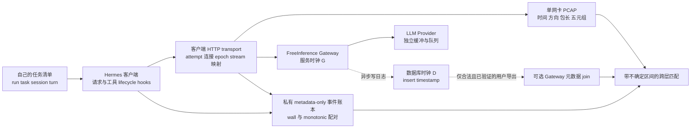

# FreeInference Trace 与客户端 PCAP 的对齐可行性

本报告区分三类材料：公开历史发布、当前公开 Gateway 源码、未来自行采集的配对实验。**现有公开历史 Parquet 不能直接为独立采集的客户端 PCAP 提供逐请求、逐包真值。**可行路径是先在自己的 Hermes 客户端建立请求事件、连接和抓包的共同观测，再将有权取得且已验证 ID 映射的 Gateway 元数据作为补充。本次没有运行 Hermes、调用模型或采集真实 Agent PCAP。

状态词：Verified 指固定源码或本次实际观察支持的事实；Partially Verified 指静态路径已找到但端到端未运行；Unknown 表示缺少证据。设计、公式和置信度规则属于本报告提出的方法，不是测得的对齐精度。

## 1. 已核实的时间与身份字段

| 对象 | 已确认事实 | 不能据此推断 |
|---|---|---|
| 历史发布 `start_ms` | `end_ms - (logged_latency_ms or 0)`；缺 latency 时起止相等 [F1] | 独立测量的 Gateway 收到首字节时间、客户端发送时间 |
| 历史发布 `end_ms` | 来自内部记录的 `timestamp`，转换为毫秒；导出代码只表明字段来源 [F1] | 记录是在末个 Provider chunk、网关写出、日志入队或 DB 插入哪一刻打点；历史物理事件语义仍 Unknown |
| 当前公开 Gateway 版本 | handler 计算 wall-clock latency；记录写入异步队列；`ledger_attribution` 明确 DB `timestamp` 是响应完成后调度的插入时间 [G4,G6] | 该版本就是历史论文采集部署；DB 时钟与 Gateway 时钟完全一致；`timestamp-latency` 无偏 |
| 论文 TTFT/latency | 论文 §3/p3 指外部转发会包括上游缓冲/排队；§9/p13 承认服务侧观测缺少精确客户端工具时延 [P] | 客户端首个 TLS 包、首字节、首个可见 token、首个 reasoning delta 与 TTFT 相同 |
| 历史 `tool_calls.latency_ms` | 同一 session 中下一 request 的推导 start 减当前 request end；同批工具共享该间隔 [F3] | 每个工具的真实执行开始/结束、网络往返或单个工具 socket 的时长 |
| 历史请求键 | 发布表以 `(session_id, step)` 关联，工具再加 `call_index`；无 IP、端口、socket/HTTP stream 和原始外部 request ID [F2] | 仅凭 PCAP 的五元组即可直接 join |

当前网站于 2026-11-10T08:13:19Z 在页脚公开链接到 Gateway commit `7f7585bc60a303f9dc8e2a0f219ab7f0b99f3255`。下文称其为“官网显示的源码版本”，不将此视作所有生产节点构建版本或历史采集版本的证明。其普通请求的 DB 插入时间与 handler latency 不同测量点，可能再涉及 Gateway 时钟 G 和数据库时钟 D，不能简单都叫同一“Gateway 时间”。详细路径见 `session_reconstruction.md` 和 `architecture.md`。

对当前版本，可用下式说明偏差来源，而不能据此给历史数据做数值修正：若 handler 在 G 上记录 `L=t_sample-t_handler_start`，DB 插入在 D 上发生于更晚的 `t_sample+q`，则 `timestamp_D-L` 包含排队/调度量 `q` 和 D–G 的时钟差。该式的假设、每条路径的 `q`、DB 事务时间和历史实现均未测量。

## 2. 当前能否取得自己的 Gateway Trace

| 路径 | 源码证据与实际检查 | 当前结论 |
|---|---|---|
| 普通用户最近请求 | `/user/recent-requests` 由 `get_current_user` 校验登录 JWT；按当前用户过滤，`limit` 钳制 1–200，`offset` 分页；返回 internal `request_id`、timestamp、latency、TTFT、stream、model/provider、token、status 等 [G1,G2]。本次无认证 GET 返回 401，未读取响应正文 | 元数据读取路径 Partially Verified；没有用户 JWT，授权后的返回和完整性 Unknown。推理 API key 不能直接当登录 JWT |
| 普通用户完整 session/原始 trace 导出 | 所审普通用户列表没有重建 session、prompt/response 或 `metadata.response_id` [G1] | 不能称已找到用户侧完整论文 Trace 导出；是否另有未审界面/接口为 Unknown |
| 管理员 JSONL 导出 | `/admin/export/requests` 要求 admin 身份；可选包含内容 [G8] | 管理权限功能；不是本实验可自行使用的普通用户导出方案，未访问 |
| 内部 grant usage | `/internal/agent-grants/{grant_id}/usage` 可返回 request/response ID、request_started_at、logged_at；整个 router 受 dispatch-token 保护 [G7] | 静态存在，不代表普通账户可用；未访问、未尝试取得内部凭据 |

### 2.1 ID 必须逐段核实

当前中间件接收/回显 `X-Request-ID` [G3]。本次在**无认证公共 GET `/v1/models`** 上用合成 ID 验证回显匹配，HTTP 200；这是 header 通道检查，不是 LLM 日志链路测试。

该通道不能直接作为数据库 join 的证明：`completions.py` 另生成内部 `req_...` ID [G4]，客户端 SSE completion ID 又不同。DB 写入会把 response 的 `id` 保存为 `metadata.response_id`，因此**存在内部桥接机制** [G5]；但所审普通用户最近请求接口不返回这个桥。内部 grant 路径能暴露桥接字段，但受额外授权保护。公开历史发布也不包含这些原始身份字段 [F2]。

未来只有在自己的响应、合法用户接口/经服务方授权的导出中实际验证共同 ID、重试、一对多关系、缺失率后，才能声称 Gateway request 已与客户端 request 精确关联。当前该端到端关系为 **Unknown**，既不能假定成立，也不能因一个 API 未暴露就断言所有授权方式永远不可行。

实际公共 GET 记录：`logs/alignment_public_http_checks.json`；复核脚本：`scripts/alignment/check_public_gateway_metadata.py`。脚本未读任何凭据、未发送 Authorization、未调用推理、未保存用户日志正文。

## 3. 对齐拓扑和观测层



“Tool execution”另有本地 CPU/文件、浏览器、SSH、HTTP 等路径；一个工具可能没有网络包，也可能触发多个连接。工具 hook 的逻辑开始/结束不等于网卡上某个唯一请求。单网卡只界定采集位置，不自动排除同机更新、DNS、辅助模型和其它进程流量。

## 4. 时钟与误差模型

### 4.1 客户端先自洽

在客户端记录每个事件的 `CLOCK_REALTIME`/`time.time_ns()` 和 `CLOCK_MONOTONIC`/`time.monotonic_ns()`；保存周期性双时钟配对。PCAP 时间戳的实际类型、分辨率和软件/硬件打点应从抓包配置查明。monotonic 仅在该主机/boot 内可比较，不能直接减服务器的 epoch 时间。发生 wall-clock 校时跳变、休眠或 boot 变化时分段拟合，禁止跨段硬凑连续时间。

记录已有 NTP/chrony 的同步状态、offset/error estimate 和采样时间；本次没有验证主机或 FreeInference 的 NTP 状态。客户端同步到公共 NTP 不是服务器也同步且误差为零的证明。无需为了实验修改系统时钟或关闭安全设置。

### 4.2 有服务器协作时的四时间戳

只有取得语义明确的服务器 receive/send 打点时，才可使用 NTP 式四时间戳：客户端发出 `c1`，服务器收到 `g2`、发出 `g3`，客户端收到 `c4`。令 `θ=G−C`，对称路径估计和网络往返时间为：

```text
theta_hat = ((g2 - c1) + (g3 - c4)) / 2
rtt_network = (c4 - c1) - (g3 - g2)
```

这是 RFC 5905 §8 的测量模型 [R1]。在双方打点位置已对齐、近似恒定 offset、单向延迟非负的条件下，保守边界为：

```text
g3 - c4 <= theta <= g2 - c1
```

上下行不对称无法由一个 RTT 消除；`RTT/2` 只是假设下的中心估计。重复采样估计 offset、drift 和区间，报告误差分布。HTTP `Date`、ICMP ping RTT 或单边 NTP 状态都不能替代上述服务器打点。**尚未核实 FreeInference 提供这样的公开校准端点**，因此不能把该公式当作本次已完成的 Gateway 校准。

### 4.3 不确定区间比单个偏移更可靠

为每个请求维护客户端事件跨度 `[a_i,e_i]`、时钟转换误差 `ε_clock`、hook/transport 打点差 `ε_hook`、抓包误差 `ε_capture`，以及适用时的服务器语义残差 `ε_semantic`。后者包含重建 start、异步日志、DB–Gateway 时钟和上游缓冲等因素；未测得就保持 Unknown，不能随意设为 0。粗粒度候选窗可写为 `[a_i−ε,e_i+ε]`；它是搜索范围，**不是窗内所有包的已证实标签**。

客户端直接配对可避免未知的跨主机绝对 offset，但仍须测量 callback 到 SDK/内核实际收发的偏差。TTFT 至少分别命名“首响应 header”“首响应 byte/chunk”“首个内容 token”；reasoning、心跳和空 SSE chunk 单独记，不将首包直接称作首 token。

## 5. 请求、连接、流与突发不是一一对应

| 单元 | 需要记录/处理 | 对分类的影响 |
|---|---|---|
| Task / session / turn | 自有清单及父子关系；session 的业务边界 | 一项任务可有多 session、多请求、多连接；不能用五元组代替任务 ID |
| Logical API call / HTTP attempt | 本地独立 `attempt_seq`、重试/redirect/fallback、辅助调用 | 一次 harness API span 可含多个 wire attempts；不能只统计 hook 数量 |
| TCP connection | PID/隔离命名空间、socket 记录、协议+双向五元组、连接开始 epoch、FIN/RST | 长连接可串行或并发承载多个请求；重用端口要区分 connection epoch |
| HTTP/2 stream | 客户端 transport 侧 stream/request 映射 | RFC 9113 §5 允许同连接多 stream 的 frame 交织 [R2]；加密 PCAP 无法仅靠五元组分开这些请求 |
| HTTP/3 / QUIC | 实测 ALPN/transport 元数据、连接身份与 stream；不能仅凭端口猜测 | HTTP 请求使用 QUIC stream；连接可迁移，五元组可变 [R3,R4]。是否实际使用 H3 本次 Unknown |
| Packet / TLS record / burst | 重传、ACK、握手、segment offload、记录合并、空闲阈值 | 一个请求可跨多突发；一个包/record 也可能混载多 stream；网络突发边界不等于请求边界 |
| Tool call | hook 逻辑事件+可选独立工具传输 instrumentation | 工具可能本地完成；多个工具并行或一个工具多请求，不能硬贴到单条网络流 |

应同时保存“wire 总字节/包数”和“去重后应用数据估计”的不同视图，明确是否保留 ACK、重传、握手。客户端 offload 设置影响抓到的包长，必须记录，不能把软件聚合大包当成跨设备一致的线上 MTU。若只捕获客户端外网 NIC，看不到代理内部 loopback 的 socket，应分别记录 proxy 两条连接，避免混用。

突发阈值属于预注册的分析参数，例如预先列出 20/50/100/500 ms 进行敏感性分析；这些只是候选阈值，不是论文验证值。连接空闲不直接宣告业务 session 结束；一个 SSE 长回复内部也可能多次停顿。

## 6. 并发与置信度规则

1. **高置信条件关联**：独立验证了 endpoint transport request/stream 到观测单位的映射，并且身份和时间一致；若一个包含多个 stream，只能标活动集合/混合，不能赋唯一请求。该映射通常不能从被动 TLS PCAP 独立恢复。
2. **中等、条件性时间候选**：同一连接 epoch 已确认只允许一个活动请求，候选窗唯一，且远离所有误差边界。仍标为 `serial_time_candidate`，不能将隔离假设当作已验证逐字节归属。
3. **低置信弱标签**：只有时间接近、包长形态相似或 Gateway 推导 start；不提供强监督真值。
4. **拒绝唯一指派**：并发窗重叠、HTTP/2/3 stream 映射缺失、边界误差可跨两个请求、连接来源不明、重试事件缺失、Gateway ID 不一致、capture 丢包/clock step 等。保留 `ambiguous/unmatched/unknown`，禁止按最近请求强配。

重传可能在请求结束后出现；不能因为超窗就贴给下一请求。严格的 byte/stream 标注需要 endpoint/解密证据，时间窗匹配只能做候选生成。处理研究者自己有权控制的 TLS 解密材料时也只能私有保存，并先评估内容暴露；本次未进行解密。

## 7. 如何验证，避免把标签和答案混在一起

先对自己的串行数据做人工审查/endpoint transport 对照，再加入并发 2、连接复用、失败重试、工具本地/远端的压力条件。报告 unmatched、ambiguous、重复 ID、孤立 start/end、capture drop、每请求候选数量、边界残差及 P50/P95，给出各观察层的有效样本分母；本次这些真实数据指标均 Unknown。

区分两种任务：①使用应用层真值边界裁好的 PCAP 片段进行分类；②仅凭网络端自行分段并分类。前者不证明后者。必须分别报告 segmentation 和 classification 的误差，并与固定时间窗/连接窗等基线比较。

标签还要记录 `label_available_at`。工具结果、completion token、最终成功和整段 session 特征若在预测时尚未产生，不能作为在线预测输入。按 task/session/user/时间分组留出；来自同一请求/连接的包和相邻窗不得随机拆进训练与测试。harness、model/provider、终点地址、API 格式、机器配置和网络条件应记录为混杂因素：单 Hermes 单模型 MVP 只能测试对齐，不能证明 harness 或 intent 分类泛化。工具 category 规则、LLM 推断 intent 和客户端直接观测事件必须保留不同标签来源。

## 8. 历史数据能否直接 join 独立 PCAP

**不能在目前证据条件下直接 join。**历史发布不是我们自己此次运行产生的数据；匿名用户/session ID、周内 block ID 没有与本地 capture 建立共同身份，公开 schema 不含 wire/stream 键，且 start 的测量语义与时钟偏移不足。恰好时间相近也不能证明同一任务或同一请求。

若要对某批历史记录做真正配对，至少须有同一授权运行、同一时间段的客户端 capture 和事件日志，并由数据所有者保留/提供原始 request/response ID 到发布 ID 的合法映射、测量打点说明、连接/stream 元数据或独占条件、时钟校准和缺失统计。缺任一关键身份条件时，只能做分布级比较、假设生成或模拟，不能用作逐包真值。

## 9. 本次实际完成与限度

- Verified：源码字段/接口/ID 路径审查；匿名公共模型 catalog GET 200 和 header echo；无认证用户 metadata GET 401。
- Verified：`python scripts/run_logged.py --log logs/alignment_synthetic_checks --timeout 30 -- python scripts/alignment/synthetic_checks.py` 于 2026-11-10T08:24:25Z 退出 0，11 个自建合成检查通过。覆盖连接复用、并发歧义、多 stream 混载、误差窗、缺连接键和迟到包；日志 `logs/alignment_synthetic_checks.log`。
- 合成检查只验证本报告保守匹配器的几个逻辑条件，不验证实际网络、Hermes、FreeInference、TLS 还原或真实对齐精度。真实 PCAP 数、Agent 运行数和模型调用数均为 0。
- Unknown：自己的 Gateway 授权导出、端到端共同 ID、当前账户 MiMo 路由、真实时间误差、并发真实标签精度和流量分类性能。

## 来源

- [P] [论文 PDF](https://data.freeinference.org/pdf/paper/from-requests-to-sessions.pdf)，§3/p3、§9/p13。
- [F1] 作者仓库 commit `2b795dbf5eac490a7c081906fdce6cc7a184b7ef`：[fields.py 的 start 公式](https://github.com/HarvardMadSys/freeinference_agentic_trace/blob/2b795dbf5eac490a7c081906fdce6cc7a184b7ef/export/log_records/fields.py#L174-L192)、[timestamp 转换](https://github.com/HarvardMadSys/freeinference_agentic_trace/blob/2b795dbf5eac490a7c081906fdce6cc7a184b7ef/export/log_records/fields.py#L30-L74)、[log_files.py 取原始 timestamp](https://github.com/HarvardMadSys/freeinference_agentic_trace/blob/2b795dbf5eac490a7c081906fdce6cc7a184b7ef/export/log_records/log_files.py#L197-L200)。
- [F2] 同 commit：[release/schema.py](https://github.com/HarvardMadSys/freeinference_agentic_trace/blob/2b795dbf5eac490a7c081906fdce6cc7a184b7ef/release/schema.py#L67-L120)。
- [F3] 同 commit：[requests_table.py](https://github.com/HarvardMadSys/freeinference_agentic_trace/blob/2b795dbf5eac490a7c081906fdce6cc7a184b7ef/export/release/requests_table.py#L178-L184)。
- [G1] 官网显示版本 `7f7585bc60a303f9dc8e2a0f219ab7f0b99f3255`：[user_routes.py](https://github.com/HarvardMadSys/hybridInference/blob/7f7585bc60a303f9dc8e2a0f219ab7f0b99f3255/apps/backend/serving/servers/routers/user_routes.py#L1279-L1388)。
- [G2] 同版本：[deps.py](https://github.com/HarvardMadSys/hybridInference/blob/7f7585bc60a303f9dc8e2a0f219ab7f0b99f3255/apps/backend/serving/servers/deps.py#L349-L393)。
- [G3] 同版本：[request_id.py](https://github.com/HarvardMadSys/hybridInference/blob/7f7585bc60a303f9dc8e2a0f219ab7f0b99f3255/apps/backend/serving/servers/middleware/request_id.py#L32-L68)。
- [G4] 同版本：[completions.py](https://github.com/HarvardMadSys/hybridInference/blob/7f7585bc60a303f9dc8e2a0f219ab7f0b99f3255/apps/backend/serving/servers/routers/completions.py#L883-L928)。
- [G5] 同版本：[postgres_log.py](https://github.com/HarvardMadSys/hybridInference/blob/7f7585bc60a303f9dc8e2a0f219ab7f0b99f3255/apps/backend/serving/storage/postgres_log.py#L238-L250)。
- [G6] 同版本：[grant_auth.py](https://github.com/HarvardMadSys/hybridInference/blob/7f7585bc60a303f9dc8e2a0f219ab7f0b99f3255/apps/backend/serving/grant_auth.py#L302-L323)。
- [G7] 同版本：[agent_grants.py，保护依赖](https://github.com/HarvardMadSys/hybridInference/blob/7f7585bc60a303f9dc8e2a0f219ab7f0b99f3255/apps/backend/serving/servers/routers/agent_grants.py#L46-L60)、[返回字段/usage 参数](https://github.com/HarvardMadSys/hybridInference/blob/7f7585bc60a303f9dc8e2a0f219ab7f0b99f3255/apps/backend/serving/servers/routers/agent_grants.py#L313-L377)。
- [G8] 同版本：[admin/export.py](https://github.com/HarvardMadSys/hybridInference/blob/7f7585bc60a303f9dc8e2a0f219ab7f0b99f3255/apps/backend/serving/servers/routers/admin/export.py#L42-L80)。
- [R1] [RFC 5905 §8](https://www.rfc-editor.org/rfc/rfc5905.html#section-8)，NTP 四时间戳 offset/delay 模型。
- [R2] [RFC 9113 §5](https://www.rfc-editor.org/rfc/rfc9113.html#section-5)，HTTP/2 streams/multiplexing。
- [R3] [RFC 9114 §4.1](https://www.rfc-editor.org/rfc/rfc9114.html#section-4.1)，HTTP/3 请求与 QUIC stream。
- [R4] [RFC 9000 §5.1、§9](https://www.rfc-editor.org/rfc/rfc9000.html#section-9)，连接 ID 与迁移。
